# CampusPilot：基于 MCP 的校园学习任务智能体

> 发布前请将文中的 `[待填写]` 替换为真实的课程链接、作业链接、GitHub 地址、成员姓名和学号。

| 这个作业属于哪个课程 | [待填写：班级圈子链接] |
| --- | --- |
| 这个作业要求在哪里 | [待填写：作业要求链接] |
| 这个作业的目标 | 使用现代 AI 工具构建一个既能自然语言对话，又能调用工具完成真实操作的智能体 |
| 学号 | [待填写：全体小组成员学号] |

## 一、项目概述

随着大语言模型从“回答问题”走向“执行任务”，智能体逐渐成为 AI 应用的重要形态。普通聊天机器人只能根据输入生成文字，而智能体还需要判断用户意图、选择合适工具、读取真实数据并执行操作。

我们实现了 **CampusPilot 校园学习任务智能体**。用户可以像与助理交谈一样描述作业、截止时间和学习需求，CampusPilot 会通过 MCP 工具把任务写入数据库、查询或修改任务、生成学习计划、查询真实天气，并把计划导出成可以下载的 Markdown 文件。

项目代码仓库：[待填写：GitHub 公共仓库链接]

## 二、需求描述

### 2.1 背景与痛点

学生的课程任务通常分散在聊天记录、课程平台和个人笔记中。传统待办软件要求用户逐项填写表单，不方便处理“下周一晚上八点前交软件工程作业，预计需要三小时”这类自然语言信息；普通聊天机器人虽然能生成计划，却不能保证任务真正写入数据库，也无法读取后续状态。

因此，本项目希望实现一个具备以下能力的校园助手：

1. 用户可以直接使用自然语言管理任务；
2. 模型自主判断应该调用哪个工具，而不是依赖关键词匹配；
3. 任务操作必须真实写入 SQLite，不能只在回复中声称成功；
4. 支持多轮上下文，例如理解“把它的优先级改成中等”中的“它”；
5. 能调用外部天气 API，并结合天气给出学习地点建议；
6. 能根据任务截止日期和每日空闲时间生成可解释的学习计划；
7. 能把计划导出为 Markdown 文件并在网页下载；
8. 删除任务等敏感操作需要二次确认。

### 2.2 功能需求

| 模块 | 功能 |
| --- | --- |
| 自然语言交互 | 理解用户对任务、天气和计划的描述，并生成中文回复 |
| 任务管理 | 新增、查询、修改、完成和删除任务 |
| 学习计划 | 根据截止日期、优先级、预计时长和每日可用时间生成安排 |
| 天气查询 | 调用 Open-Meteo 查询指定城市的真实逐日天气 |
| 多轮记忆 | 保存历史会话，并理解上下文中的指代关系 |
| 文件导出 | 将学习计划生成 Markdown 文件并提供下载按钮 |
| 安全机制 | 删除前展示任务详情并要求用户明确确认 |
| 可视化界面 | 展示聊天记录、任务统计、MCP 调用过程和导出文件 |

### 2.3 非功能需求

- API Key 只保存在 `.env`，不提交到公共仓库；
- 模型不能直接执行 SQL，所有操作必须经过受控工具；
- 导出文件只能写入指定的 `exports/` 目录；
- 外部 API 或模型服务失败时，系统应返回明确错误，不能伪造结果；
- 核心数据库、计划算法和 MCP 工具应具备自动化测试。

## 三、业务流程描述

一次完整的智能体交互流程如下：

1. 用户在 Streamlit 网页输入自然语言；
2. Agent 将系统提示词、历史消息和 MCP 工具定义发送给大语言模型；
3. 模型分析意图并返回需要调用的工具及 JSON 参数；
4. MCP Client 将调用发送给 MCP Server；
5. MCP Server 执行数据库、天气查询或文件导出操作；
6. 工具执行结果返回给模型；
7. 模型根据真实结果组织最终回复；
8. 用户消息和最终回复保存到 SQLite，供下一轮对话继续使用。

删除任务时增加一个安全分支：第一次调用只返回待删除任务的详情，模型向用户询问；收到“确认删除”后，工具才真正执行删除。

## 四、系统架构

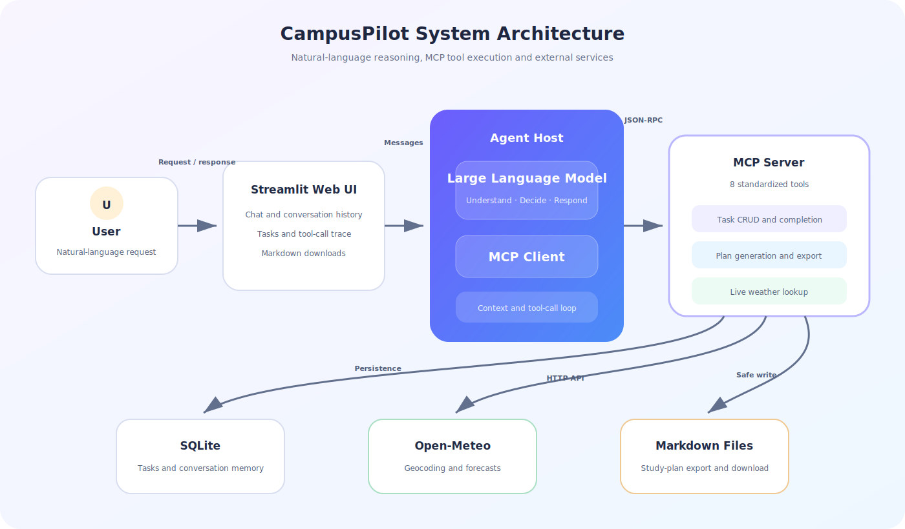

系统分为五个主要部分：

- **Streamlit 前端**：负责对话界面、历史记录、任务概览、工具过程和文件下载；
- **Agent Host**：维护上下文，将工具 Schema 提供给模型，并循环处理 Tool Calling；
- **MCP Client**：按照 MCP 协议发现和调用工具；
- **MCP Server**：暴露八个标准化工具，集中处理可执行操作；
- **数据与外部服务**：SQLite 保存任务和会话，Open-Meteo 提供天气，`exports/` 保存计划文件。

这里的关键点是：**模型负责理解、决策和表达，工具负责真实执行**。即使更换大语言模型，MCP 工具层仍然可以复用。

## 五、技术选型

| 技术 | 用途 | 选择原因 |
| --- | --- | --- |
| Python 3.11+ | 主要开发语言 | 生态完善，适合快速构建 AI 应用 |
| MCP Python SDK 2.3 | MCP Server 与 Client | 官方 SDK，可自动生成工具 Schema |
| OpenAI 兼容模型接口 | 意图理解和 Tool Calling | 接口通用，便于替换不同模型服务 |
| Streamlit 1.55 | Web 前端 | 能快速构建聊天界面和状态面板 |
| SQLite | 任务与聊天数据 | 无需单独部署，适合课程项目 |
| Open-Meteo | 天气数据 | 非商业使用无需单独申请 API Key |
| unittest | 自动化测试 | Python 标准库内置，部署简单 |

## 六、实现说明

### 6.1 项目结构

```text
agent/
├── campus_pilot/
│   ├── agent.py          # Agent 调用循环与系统提示词
│   ├── cli.py            # 终端入口
│   ├── database.py       # 任务与聊天记录持久化
│   ├── exporter.py       # Markdown 渲染和安全导出
│   ├── mcp_server.py     # MCP Server 与八个工具
│   ├── planner.py        # 确定性学习计划算法
│   ├── weather.py        # Open-Meteo 接口封装
│   └── web.py            # Streamlit 网页
├── tests/                # 自动化测试
├── data/                 # SQLite 数据库（不提交真实数据）
├── exports/              # 导出的学习计划
├── .env.example
├── requirements.txt
└── README.md
```

### 6.2 MCP 工具设计

本项目共提供八个 MCP 工具：

| 工具 | 主要参数 | 实际操作 |
| --- | --- | --- |
| `add_task` | 标题、截止时间、课程、预计时长、优先级 | 新建任务 |
| `list_tasks` | 状态 | 查询任务 |
| `update_task` | 任务 ID 和待修改字段 | 修改任务 |
| `complete_task` | 任务 ID | 标记完成 |
| `delete_task` | 任务 ID、确认状态 | 预览或删除任务 |
| `generate_study_plan` | 开始日期、每日分钟数、天数 | 生成按日计划 |
| `get_weather` | 城市、开始日期、天数 | 查询逐日天气 |
| `export_study_plan` | 计划参数、文件名 | 生成 Markdown 文件 |

SDK 会根据函数签名、类型注解和文档字符串生成 JSON Schema。模型看到这些 Schema 后，可以自主决定何时调用工具以及如何填写参数。

### 6.3 Agent 调用循环

Agent 首先通过 MCP Client 获取工具列表，并转换成模型支持的 Tool Calling 格式。每轮交互的核心逻辑是：

```text
把用户消息加入上下文
while 未得到最终文本回复:
    调用大语言模型
    if 模型返回工具调用:
        通过 MCP Client 执行工具
        把真实工具结果加入上下文
    else:
        保存并返回最终回复
```

为了防止模型无限循环，程序设置了最大工具调用轮数。工具异常会被转换成明确错误结果，再交给模型解释，系统不会把失败描述为成功。

### 6.4 SQLite 持久化与记忆

数据库包含三张核心表：

- `tasks`：保存任务标题、课程、截止时间、预计时长、优先级和状态；
- `conversations`：保存会话标题和更新时间；
- `messages`：保存用户与助手的可见消息。

网页每次收到新输入时，会加载当前会话最近的消息并交给 Agent。因此即使页面重新渲染，用户仍能继续之前的对话。所有 SQL 都由仓库层使用参数化语句执行，模型没有直接执行 SQL 的权限。

### 6.5 可解释的计划算法

学习计划并不是让模型自由编造，而是由确定性算法完成：

1. 过滤已完成任务；
2. 按截止日期和优先级排序；
3. 从开始日期逐日分配可用时间；
4. 每个学习块最多 60 分钟；
5. 不把任务排到截止日期之后；
6. 容量不足时返回未排入任务及剩余分钟数。

模型只负责把算法输出整理成更易读的表格和建议，从而提高结果的稳定性与可验证性。

### 6.6 外部天气 API

天气工具先调用 Open-Meteo Geocoding API 把城市名称解析成经纬度，再调用 Forecast API 获取天气代码、最高温、最低温和最大降水概率。程序将天气代码转换为中文描述，然后由模型结合用户的出行或学习需求给出建议。

网络请求设置了超时，并对空城市、错误日期、超出范围的查询天数和找不到城市等情况进行校验。

### 6.7 文件导出与安全控制

导出工具复用计划算法生成数据，然后渲染成 Markdown 清单。文件名会先去除目录部分并过滤特殊字符，最终文件只能落在 `exports/` 目录，避免路径穿越。网页检测到导出工具成功后会自动重新渲染，用户无需手动刷新即可看到下载按钮。

### 6.8 配置与运行

安装依赖：

```bash
python3 -m venv .venv
source .venv/bin/activate
pip install -r requirements.txt
cp .env.example .env
```

在 `.env` 中配置模型服务。真实密钥不能提交到 GitHub：

```dotenv
LLM_API_KEY=你的密钥
LLM_MODEL=模型名称
LLM_BASE_URL=OpenAI兼容接口地址
```

启动网页：

```bash
.venv/bin/streamlit run campus_pilot/web.py
```

浏览器访问 `http://localhost:8501`。

## 七、使用示例与功能演示

### 7.1 系统首页

首页左侧可以新建或切换历史对话，同时展示待完成任务、已完成任务和任务详情。

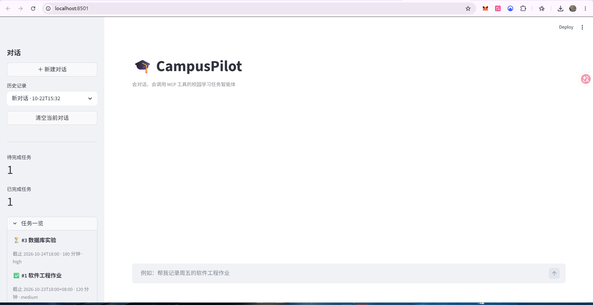

### 7.2 使用自然语言创建任务

用户输入“本周五下午六点前完成软件工程作业，预计需要 3 小时，优先级高”，模型自动提取字段并调用 `add_task`。页面显示了真实 MCP 工具名称和 JSON 参数，证明任务不是只存在于回复文本中。

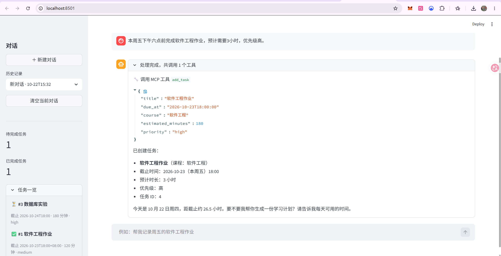

### 7.3 修改截止时间

用户不需要打开表单，只需说明新的截止时间。Agent 识别目标任务后调用 `update_task`，数据库和侧边栏同步更新。

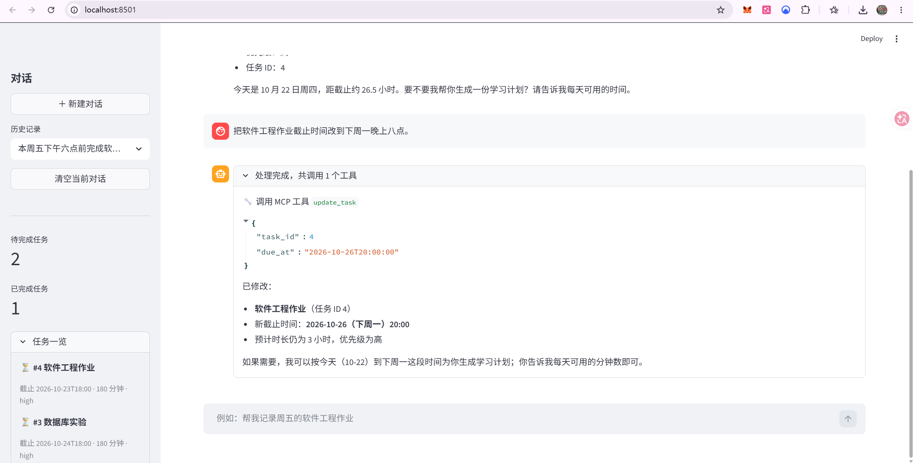

### 7.4 多轮对话记忆

用户继续输入“把它的优先级改成中等”，Agent 能根据前文判断“它”指刚刚修改的软件工程作业，并正确调用同一任务 ID 的更新工具。

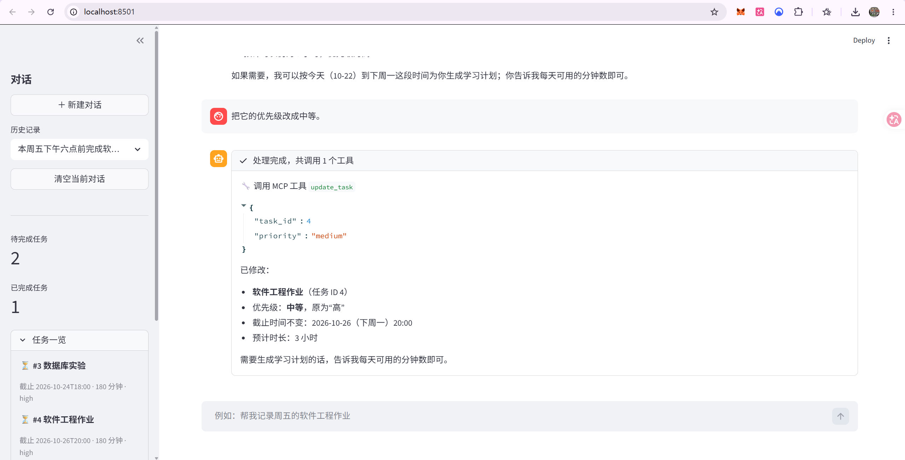

### 7.5 查询真实天气

用户询问明天上海是否适合去图书馆。Agent 调用 `get_weather`，获得日期、天气、降水概率和温度后再给出出行建议，而不是使用模型训练数据猜测实时天气。

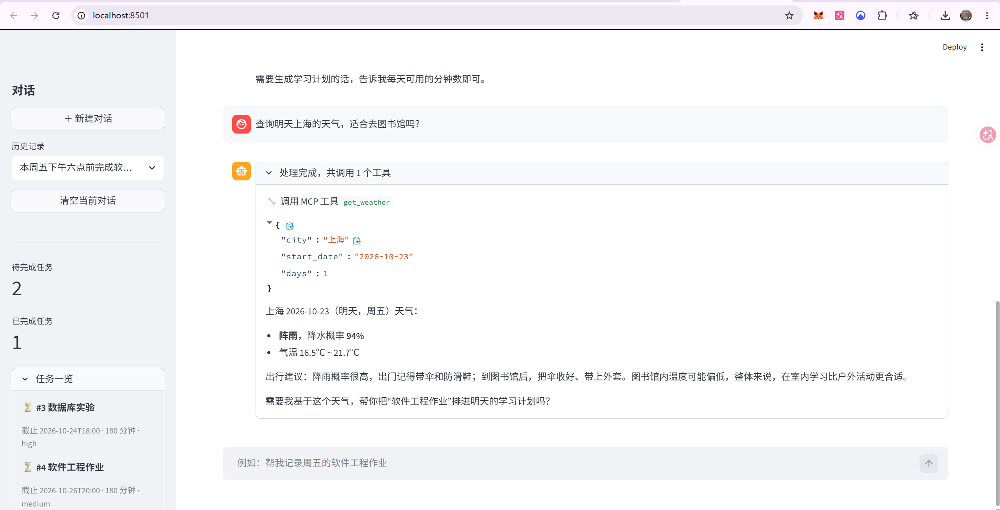

### 7.6 生成学习计划

用户指定未来七天每天可学习两小时。计划工具读取所有未完成任务，按照截止日期分配学习块，并明确展示总任务时长和剩余容量。

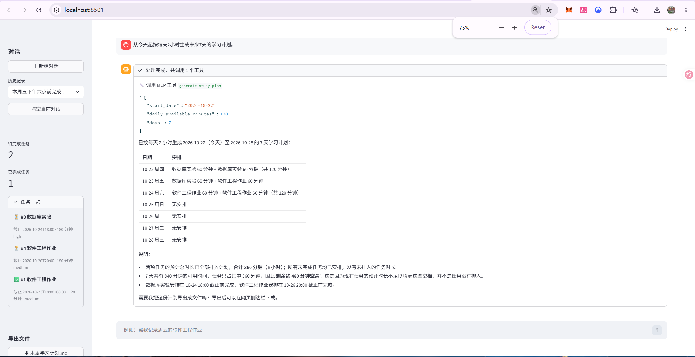

### 7.7 导出并下载 Markdown

用户要求将计划导出为“本周学习计划.md”。工具在受限目录生成文件，网页左侧随即出现下载按钮。

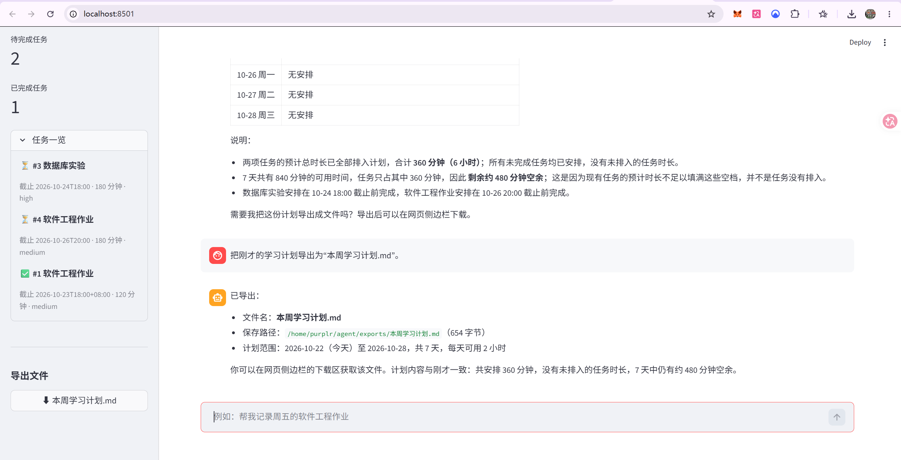

导出后的回复还会说明文件名、保存位置、计划范围和总时长，用户可以直接验证文件内容。

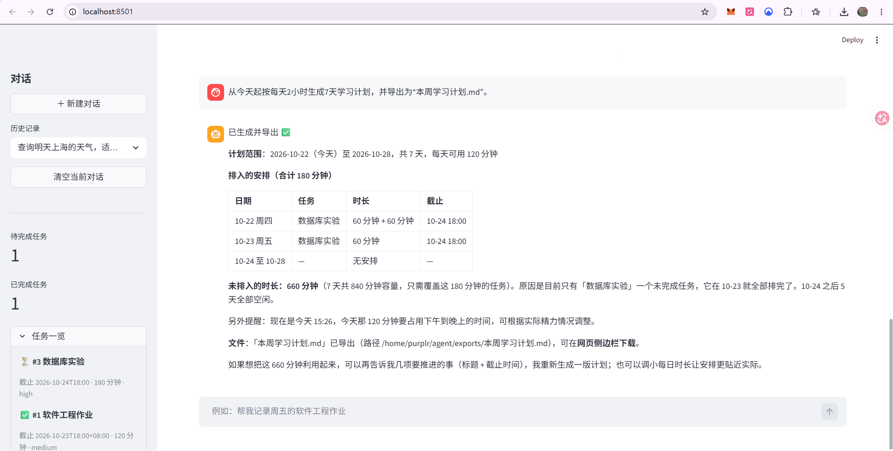

### 7.8 删除二次确认

用户要求删除任务时，第一次调用 `delete_task` 使用 `confirmed=false`，系统只显示任务详情，不执行删除。

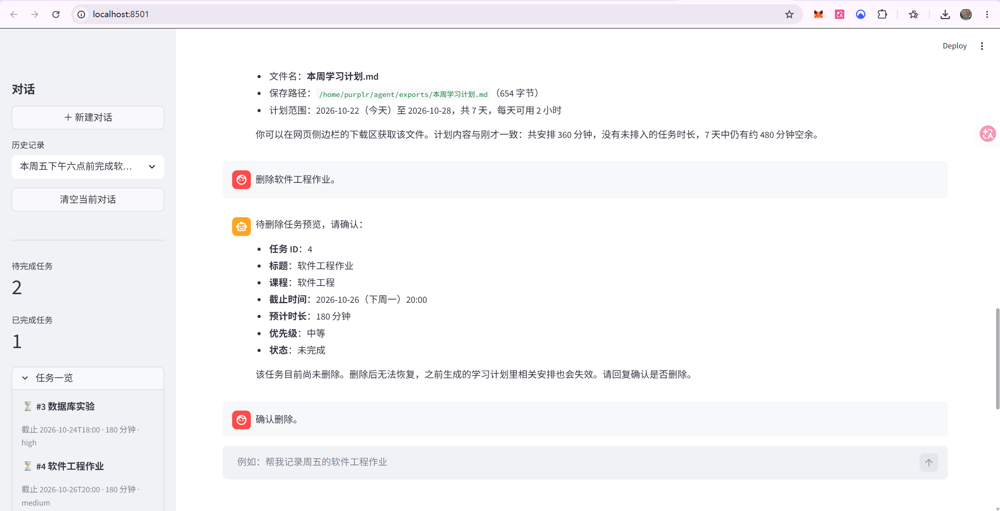

用户明确回复“确认删除”后，工具才使用 `confirmed=true` 完成删除，并再次查询当前任务列表。这体现了智能体执行有副作用操作时的安全控制。

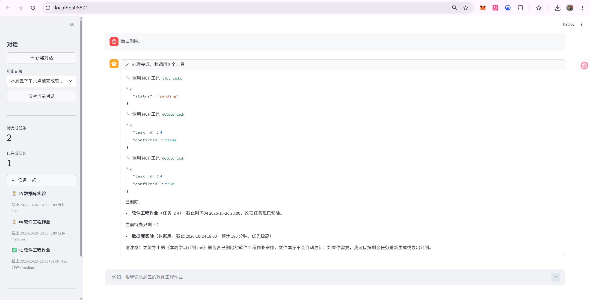

## 八、测试与结果

项目使用 Python `unittest` 覆盖以下内容：

- 任务新增、查询、排序、修改、完成和删除；
- MCP 工具发现与端到端调用；
- Agent 调用模型、执行工具、回传结果的完整循环；
- 聊天记录跨仓库实例持久化；
- 计划容量、截止日期和非法参数校验；
- 天气地理编码与预报结果标准化；
- Markdown 渲染、导出和路径越界防护。

运行命令：

```bash
.venv/bin/python -m unittest discover -s tests -v
```

共运行 15 项测试，全部通过：

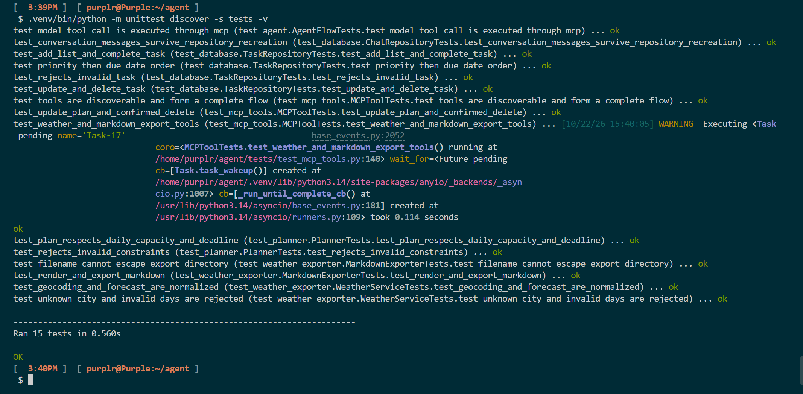

## 九、项目特色与加分项

1. **真实 MCP 架构**：Agent 通过 MCP Client 发现和调用独立工具，而不是在业务代码中用关键词判断；
2. **多轮持久化记忆**：历史会话保存在 SQLite，页面重新渲染后仍能恢复；
3. **外部 API**：天气结果来自 Open-Meteo；
4. **简洁前端**：Streamlit 同时展示聊天、任务状态和工具调用轨迹；
5. **文件生成**：计划可导出成 Markdown 并直接下载；
6. **安全设计**：删除需要确认，文件导出限制路径，密钥不进入仓库；
7. **可测试性**：HTTP 层、数据库层和 MCP Server 均支持依赖注入和隔离测试。

语音输入/输出属于可选加分项，本项目没有实现。我们把开发重点放在 MCP 工具调用的真实性、数据持久化、外部 API、前端展示和操作安全上。

## 十、小组分工

> 请根据实际人数增删下表，并将占位内容替换为真实信息。

| 成员 | 学号 | 主要分工 |
| --- | --- | --- |
| [成员 1 姓名] | [学号] | 需求分析、Agent 调用循环、模型提示词与项目整合 |
| [成员 2 姓名] | [学号] | MCP Server、SQLite 数据层和任务管理工具 |
| [成员 3 姓名] | [学号] | Streamlit 前端、天气 API 和 Markdown 导出 |
| [成员 4 姓名] | [学号] | 自动化测试、演示截图、README 与博客整理 |

协作过程中以功能模块划分任务，并通过 Git 提交记录代码演进。接口发生变化时先同步工具 Schema 和数据结构，再分别完成实现、测试与文档更新。

## 十一、成员心得

### [成员 1 姓名]

这次作业让我真正理解了智能体与普通聊天机器人的区别。大语言模型并不直接完成数据库操作，而是根据自然语言选择工具，再根据工具返回的真实结果组织回答。实现调用循环时，我也认识到工具描述、参数 Schema 和系统提示词会直接影响模型调用的准确性。

### [成员 2 姓名]

我主要关注 MCP 工具和数据层。把数据库操作封装成边界清晰的工具之后，模型只能执行我们允许的动作，代码也更容易测试。删除二次确认和参数校验让我意识到，智能体不仅要“能做”，还必须考虑误操作、安全边界和失败处理。

### [成员 3 姓名]

在完成前端和外部 API 接入的过程中，我学习了 Streamlit 的会话状态与重新渲染机制，也理解了真实 API 与模型知识的区别。天气数据必须由工具实时查询，模型只负责解释，这样才能避免看似合理但已经过时的回答。

### [成员 4 姓名]

编写自动化测试让我发现，智能体项目不能只依靠页面演示判断正确性。数据库、计划算法、天气解析、文件路径安全和 MCP 调用链都需要独立验证。测试也帮助我们在继续扩展功能时及时发现回归问题。

## 十二、问题与解决过程

### 12.1 Streamlit 无法导入项目包

直接执行 `streamlit run campus_pilot/web.py` 时，Streamlit 只把脚本目录加入模块搜索路径，最初出现 `ModuleNotFoundError`。我们在网页入口中解析项目根目录并显式加入 `sys.path`，随后从项目目录外执行脚本和启动服务均验证成功。

### 12.2 导出文件需要手动刷新才能下载

侧边栏先于聊天工具执行，因此同一轮渲染时读取不到刚生成的文件。解决方法是在检测到 `export_study_plan` 成功调用后设置 Session State 标志并自动 `rerun`。回复已经持久化到 SQLite，所以重新渲染不会丢失对话。

### 12.3 SQLite 连接资源警告

Python 的 SQLite 连接上下文管理器负责事务，但不一定主动关闭连接。测试发现资源警告后，我们实现了自己的上下文管理器，在成功时提交、异常时回滚，并在所有路径显式关闭连接。

## 十三、学习资源推荐

1. [Model Context Protocol 官方文档](https://modelcontextprotocol.io/)
2. [MCP Python SDK](https://py.sdk.modelcontextprotocol.io/)
3. [Streamlit Chat 应用教程](https://docs.streamlit.io/develop/tutorials/chat-and-llm-apps/build-conversational-apps)
4. [Open-Meteo Forecast API](https://open-meteo.com/en/docs)
5. [SQLite 官方文档](https://www.sqlite.org/docs.html)
6. [Python unittest 文档](https://docs.python.org/3/library/unittest.html)

## 十四、总结

CampusPilot 完成了从自然语言输入到真实工具执行的闭环：模型理解用户意图，MCP 提供标准化能力，SQLite 保存任务与记忆，Open-Meteo 提供实时外部数据，Streamlit 展示执行过程，Markdown 导出则把结果转化为可继续使用的文件。

通过本项目，我们不仅完成了一个“会说”的聊天界面，也实现了一个真正“会做”的智能体。后续可以继续扩展课程表导入、日历同步、消息提醒、多用户认证和更细粒度的时间段排程。
