**CampusPilot**

*基于 MCP 的校园学习任务智能体*

# 系统设计说明书

*System Design Description（SDD）· 概要设计阶段*

| 文档编号 | CP-SDD-1.0 |
| --- | --- |
| 项目名称 | CampusPilot：基于 MCP 的校园学习任务智能体 |
| 团队名称 | 你说的都队 |
| 文档版本 | V1.0 |
| 密级 | 课程作业内部文档 |
| 编制日期 | 2026 年 11 月 16 日 |
| 代码仓库 | https://github.com/gitgdut/campus_pilot |

你说的都队　赵佳鑫 · 库德来提 · 陈凯壕

## 文档信息

| 文档名称 | 《你说的都队_系统设计说明书》 |
| --- | --- |
| 项目全称 | CampusPilot：基于 MCP 的校园学习任务智能体 |
| 项目简称 | CampusPilot |
| 设计基线 | v1.0（含已实现功能 v0.1.0 与本期设计新增部分） |
| 编制依据 | GB/T 8567-2006《计算机软件文档编制规范》系统设计说明书结构 |
| 适用读者 | 开发人员、评审人、指导教师与助教、后续维护者 |
| 团队分工 | 赵佳鑫（统筹与主笔）、库德来提（工具与数据）、陈凯壕（界面与外部接口） |
| 代码仓库 | https://github.com/gitgdut/campus_pilot |
| 在线访问 | https://campuspilo-pnwkhalibgupspw6bmme3v.streamlit.app/ |

## 修订记录

| 版本 | 日期 | 修订内容 | 修订人 | 审核 |
| --- | --- | --- | --- | --- |
| V0.5 | 2026-11-08 | 需求分析文档定稿（功能 F1–F9、验收 A1–A11） | 赵佳鑫 | 团队 |
| V1.0 | 2026-11-16 | 补齐概要设计：五层架构、UML 五图、接口、运行、出错处理；新增后台管理端设计 | 赵佳鑫 | 团队 |

## 目录

- 系统设计说明书
  - 文档信息
  - 修订记录
  - 目录

- 第1章 引言
  - 1.1 编写目的
  - 1.2 背景
  - 1.3 定义与缩略语
  - 1.4 参考资料

- 第2章 总体设计
  - 2.1 需求规定
  - 2.2 运行环境
  - 2.3 基本设计概念和处理流程
  - 2.4 系统结构
  - 2.5 功能需求与程序的关系
  - 2.6 人工处理过程
  - 2.7 尚未解决的问题

- 第3章 接口设计
  - 3.1 用户接口
  - 3.2 外部接口
  - 3.3 内部接口

- 第4章 运行设计
  - 4.1 运行模块组合
  - 4.2 运行控制
  - 4.3 运行时间

- 第5章 系统数据结构设计
  - 5.1 逻辑结构设计要点
  - 5.2 物理结构设计要点
  - 5.3 数据结构与程序的关系

- 第6章 系统出错处理设计
  - 6.1 出错信息
  - 6.2 补救措施
  - 6.3 系统维护设计

- 第7章 需求可追踪性与验证
  - 7.1 追踪矩阵
  - 7.2 验证方法与测试覆盖

- 第8章 附录
  - 附录 A 图形符号说明
  - 附录 B 代码索引

说明：本文件为 Word 版提交稿。首次打开若提示「是否更新域」，请选择「是」；也可全选后按 F9 更新，目录页码会按 Word 实际分页生成。

# 第1章 引言

## 1.1 编写目的

本文档是 CampusPilot 概要设计阶段的系统设计说明书，说明系统从需求到实现的总体设计决策：系统被划分为哪几层、每层由哪些模块组成、模块之间通过什么接口协作、一次典型请求如何在系统中流动、数据结构如何组织、出错时如何处置。

文档面向三类读者：开发人员据此编码与自测；评审人（指导教师、助教）据此判断设计是否完整自洽；后续维护者据此理解「为什么这样设计」而不是重新推翻。本文不重复需求文档已写清的验收标准，只说明为满足这些标准所做的设计选择。

全文遵循「自顶向下、逐层细化」的组织方式：第 2 章停留在系统级（有哪些层、有哪些模块），第 3 章进入接口级（层与层之间怎么说话），第 4 章进入运行级（一次请求的时序与资源），第 5 章进入数据结构级，第 6 章细化到错误码与处置动作。阅读时若只关心结论，看每节首段与表格即可。

## 1.2 背景

**项目名称**：CampusPilot：基于 MCP 的校园学习任务智能体（英文标识 CampusPilot）。

**任务提出者**：软件工程课程（计科 24 级 56 班）第二次团队作业，要求完成原型设计与概要设计。

**开发者与用户**：开发者为你说的都队三人；最终用户为在校大学生，典型场景是课程作业、实验报告与考试复习的任务管理。

**软件定位**：一个可访问的 Web 应用（Streamlit 页面），用户用自然语言下达任务、生成计划与导出文件。

**外部关系**：系统通过 HTTPS 调用大模型服务（OpenAI 兼容接口，当前使用 DeepSeek）与天气服务（Open-Meteo）；不接入教务系统、不做硬件联动，本期不涉及与第三方业务系统的数据交换。

**与上一阶段的关系**：第一次作业已交付团队展示、选题报告与需求分析文档（含 F1–F9 功能、FR-01–FR-08 前端需求、BR-01–BR-08 后端需求、A1–A11 验收条目）；本文以其为输入，并把每个需求条目落到具体模块、接口与错误码上。

## 1.3 定义与缩略语

本文使用的缩略语与专门术语如下表；全文统一使用表中的写法，不再另作解释。

**表 1-1　缩略语与术语表**

| 缩写 / 术语 | 英文全称 | 含义 |
| --- | --- | --- |
| MCP | Model Context Protocol | 模型发现并调用外部工具的标准化协议；本项目用官方 Python SDK 2.3.0 实现服务端与客户端 |
| LLM | Large Language Model | 大语言模型；本项目通过 OpenAI 兼容接口调用 |
| Tool Calling | Tool Calling / Function Calling | 模型返回「调用哪个工具、传什么 JSON 参数」的能力 |
| JSON-RPC | JSON Remote Procedure Call | MCP 使用的消息格式：请求含 method 与 params，响应含 result 或 error |
| stdio | Standard Input/Output | MCP Server 与 Client 之间的传输方式：宿主进程通过标准输入输出与子进程通信 |
| UML | Unified Modeling Language | 统一建模语言，本文用例图、活动图、类图、时序图、协作图、状态图、部署图均按 UML 2.5 记法绘制 |
| ER | Entity-Relationship | 实体—联系模型，用于数据库概念结构设计 |
| ORM | Object-Relational Mapping | 对象—关系映射；本项目未引入 ORM 框架，本文以「实体类↔表↔字段」映射表说明对应关系 |
| DDL | Data Definition Language | 数据定义语言，如 CREATE TABLE |
| SRS | Software Requirements Specification | 软件需求规格说明，对应第一次作业的需求分析文档 |
| SDD | System Design Description | 系统设计说明书，即本文 |
| DBDD | Database Design Description | 数据库设计说明书，与本文件配套提交 |
| ISO 8601 | ISO 8601 | 日期时间表示标准；本项目截止时间入库规范为 2026-11-20T18:00 |
| WAL | Write-Ahead Logging | SQLite 的一种日志模式，可提升并发读写能力；本文作为物理设计建议 |
| KPI | Key Performance Indicator | 关键指标，用于后台看板与运行监控 |

## 1.4 参考资料

**表 1-2　参考资料清单**

| 编号 | 资料名称 | 说明 |
| --- | --- | --- |
| R1 | GB/T 8567-2006《计算机软件文档编制规范》 | 系统设计说明书的章节结构依据 |
| R2 | GB/T 9385-2008《计算机软件需求规格说明规范》 | 需求文档（SRS）的编写依据，与本文需求条目对应 |
| R3 | GB/T 11457《软件工程术语》 | 术语与缩略语的中文表述依据 |
| R4 | 《CampusPilot 需求分析文档》v0.5 | 第一次作业第三部分，本文的输入 |
| R5 | campus_pilot 代码仓库 README 与源码 | 所有模块、类、方法、表结构、常量的真实来源 |
| R6 | MCP 官方文档（Python SDK 2.3.0） | 工具注册、stdio 传输与调用返回结构的依据 |
| R7 | Open-Meteo API 文档 | 地理编码与逐日预报接口参数与返回字段 |
| R8 | CampusPilot 高保真原型（20 屏） | 本文 3.1 节界面设计与截图来源 |

# 第2章 总体设计

## 2.1 需求规定

本节把需求文档中的功能条目固化为设计输入。功能编号 F1–F9 沿用需求文档，F10 为本次概要设计新增的后台管理功能；「实现状态」列区分已实现与本期设计，避免把规划写成已完成。

**表 2-1　功能需求与实现状态**

| 编号 | 功能域 | 功能点 | 优先级 | 实现状态 |
| --- | --- | --- | --- | --- |
| F1 | 自然语言交互 | 理解用户对任务、天气与计划的描述并生成中文回复 | 高 | 已实现 |
| F2 | 任务管理 | 新增、查询、修改、完成、删除任务（删除需二次确认） | 高 | 已实现 |
| F3 | 学习计划 | 按截止日期、优先级、预计时长与每日容量生成按日计划 | 高 | 已实现 |
| F4 | 天气查询 | 查询指定城市的真实逐日天气（21 种天气码转中文） | 中 | 已实现 |
| F5 | 多轮记忆 | 持久化会话与消息，理解上下文指代 | 高 | 已实现 |
| F6 | 文件导出 | 生成 Markdown 计划文件并从网页下载 | 中 | 已实现 |
| F7 | 安全机制 | 删除确认、导出目录限制、密钥不入库 | 高 | 已实现 |
| F8 | 可视化界面 | 展示聊天、任务统计、工具调用轨迹与导出文件 | 高 | 已实现 |
| F9 | 质量保障 | 覆盖数据库、算法、天气、导出与调用链的 15 项自动化测试 | 高 | 已实现 |
| F10 | 后台管理 | 数据看板、任务与会话审计、工具日志、导出文件管理、系统配置与权限 | 中 | 本期设计 |

上表 10 项功能在设计上被映射为 5 个功能域：对话与记忆、任务管理、计划与天气、导出与下载、后台数据与配置（见下图功能结构图）。每个功能域都对应明确的前端页面与后端模块，不存在「有需求但无归属」的悬空条目。

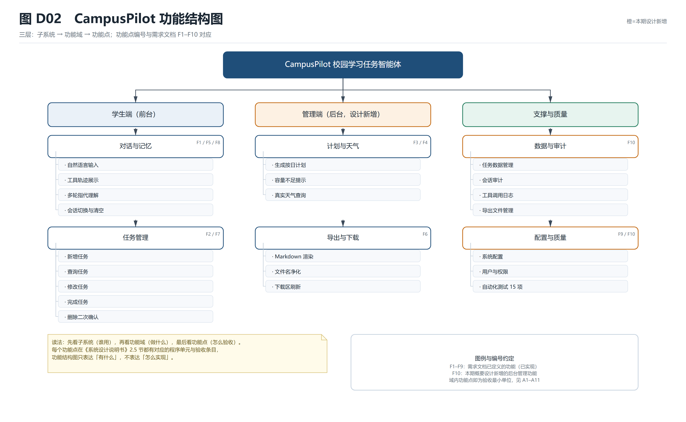

*图 2-1　CampusPilot 功能结构图（子系统—功能域—功能点）*

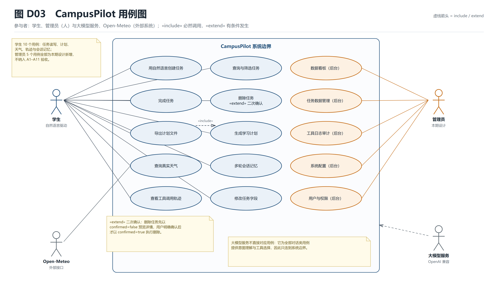

*图 2-2　用例图：学生端 10 个用例与后台 5 个用例（含 «include» / «extend»）*

用例图给出系统的参与者与用例边界：参与者分两类——人（学生、管理员）与外部系统（大模型服务、Open-Meteo）；«include» 表示必然发生的调用（如导出计划必然先经过确定性排程），«extend» 表示有条件发生的动作（删除任务先预览、确认后才执行）。后台 5 个用例本期只做设计，不纳入 A1–A11 验收。

从需求到设计的收敛规则有三条，贯穿全文：一是「凡是涉及数据变更的需求，必须落到受控工具」，因此 F2、F3、F6 全部由 8 个 MCP 工具承载；二是「凡是涉及外部实时数据的需求，必须由工具实时获取」，因此 F4 不允许模型用训练数据代替；三是「凡是涉及破坏性操作的需求，必须有两段式确认」，因此 F7 不是界面提示，而是工具参数 confirmed 的语义。

## 2.2 运行环境

CampusPilot 采用单机部署：一个 Streamlit 进程承载页面与智能体，一个 MCP Server 子进程承载工具，一个 SQLite 文件承载数据。这样做的原因不是技术偏好，而是课程项目的资源约束：无需数据库服务、无需容器编排，助教按 README 三条命令即可复现。

**表 2-2　运行环境与依赖**

| 层次 | 组件 | 版本 / 规格 | 说明 |
| --- | --- | --- | --- |
| 客户端 | 浏览器 | Chrome / Edge / Safari 近两年版本 | 无需安装插件；界面为宽屏布局，最小 1280×720 |
| 运行时 | Python | ≥ 3.11（开发环境 3.12） | 使用 asyncio、类型注解、zoneinfo |
| 依赖 | mcp[cli] | 2.3.0（精确固定） | MCP Server 与 Client，stdio 传输 |
| 依赖 | openai | 3.36.1（精确固定） | OpenAI 兼容接口客户端，指向 DeepSeek |
| 依赖 | streamlit | 1.55.0（精确固定） | Web 前端与状态管理 |
| 存储 | SQLite | 3.x（Python 标准库 sqlite3） | 单文件数据库 data/tasks.db |
| 网络 | 出方向 HTTPS | 443 | 访问大模型服务与 Open-Meteo；无需入方向端口 |
| 部署 | 在线演示（已上线） | Streamlit Community Cloud | 公开实例，评审无需本地部署即可体验；闲置休眠后首次访问约需 30 秒唤醒 |
| 部署 | 公网访问（可选） | Cloudflare Tunnel → 本地 8501 | 演示期使用；不作为系统组成部分 |

> 在线演示地址：https://campuspilo-pnwkhalibgupspw6bmme3v.streamlit.app/　（项目已部署于 Streamlit Community Cloud，可直接用浏览器打开体验学生端完整流程；免费实例长时间无人访问会自动休眠，首次打开需等待约 30 秒唤醒。）

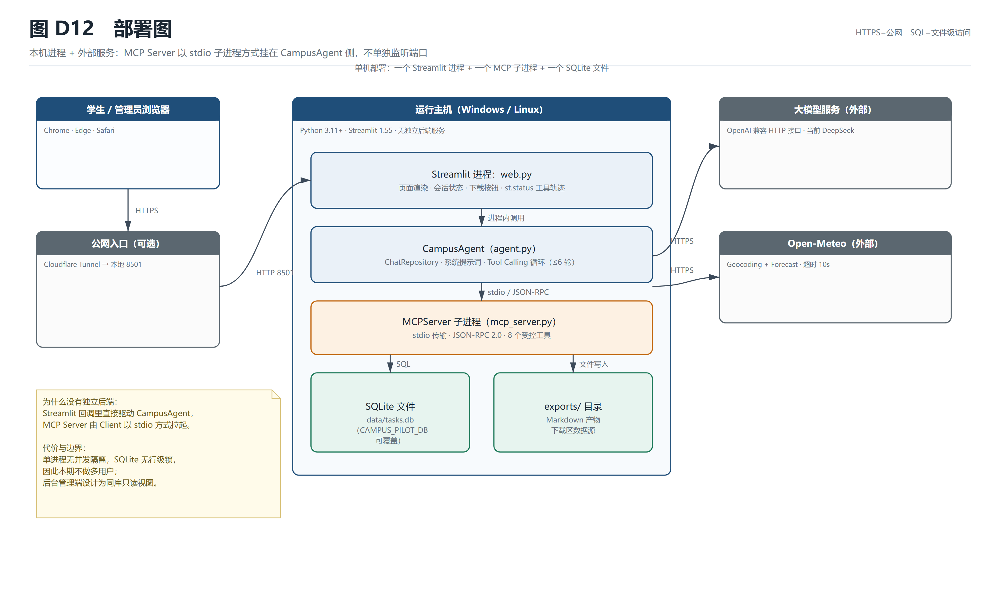

*图 2-3　CampusPilot 部署图（单机进程 + 外部服务）*

部署上的关键约束是「MCP Server 不监听端口」：它以 stdio 子进程方式由 Client 拉起，因此不存在工具层的网络暴露面，也就不需要给工具层单独做鉴权。这一设计直接决定了第 6 章的安全边界：攻击面只有 Web 页面与两个外部 HTTPS 调用。

## 2.3 基本设计概念和处理流程

本节先给出六条设计原则，再用三张图说明它们如何体现在业务流程里。原则之间不是并列关系，而是「先划边界、再定算法、最后保证可解释」的递进关系。

### 2.3.1 六条设计原则

- 分层不越界：模型层不持有数据库连接，工具层不做业务决策，界面层不直接写库；跨层只通过第 3 章的接口通信。
- 模型只做决策：意图理解、工具选择、自然语言组织交给模型；排序、分块、校验、写盘交给确定性代码。
- 受控工具白名单：模型能做的事被 8 个工具的签名严格限定，没有任意 SQL、没有任意文件路径。
- 确定性算法优先：学习计划由 StudyPlanner 按截止日期与优先级计算，同样的输入必然得到同样的输出。
- 执行过程可解释：每次工具调用的名称与参数在界面可见，并在本期设计中落库到 tool_calls 表。
- 失败不伪造：外部服务失败、参数非法、轮数耗尽都以明确错误返回，系统任何路径都不把失败描述为成功。

### 2.3.2 主流程：一句话创建任务

用户用一句自然语言描述作业，系统需要在同一轮对话内完成「意图识别 → 字段抽取 → 参数校验 → 真实落库 → 如实回复」。下图给出该流程的活动图，泳道表示动作的执行者；两条虚线分支分别是「字段不全则追问」与「参数非法则报错回灌」，它们保证了系统不会在信息不足时臆造任务。

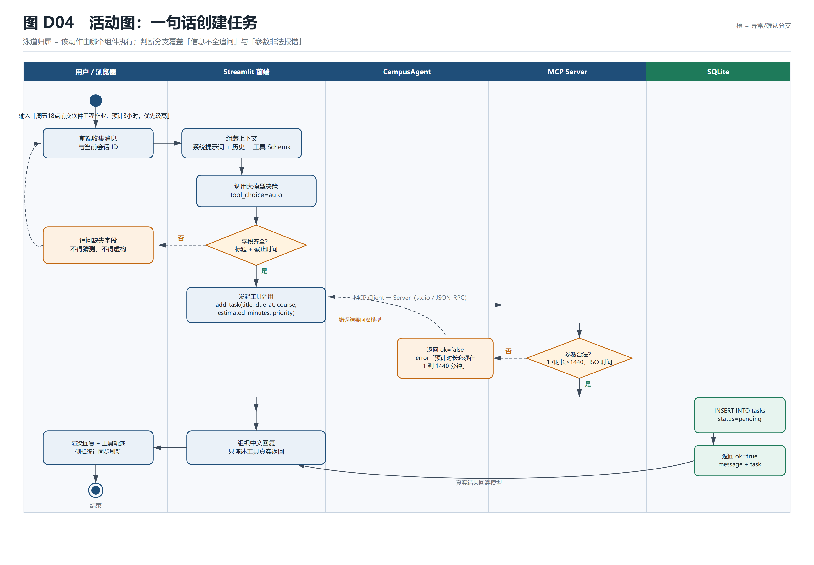

*图 2-4　活动图：一句话创建任务的完整流程*

### 2.3.3 主流程：计划生成与导出

计划生成是本项目最核心的「杀手级功能」，其设计要点在于：模型不参与编排。下图中，StudyPlanner 按「截止日期升序 → 优先级 high/medium/low」排序，再逐日分配容量，单个学习块取 min(剩余分钟, 当日容量, 60)；若某任务在截止日之前排不下，则整条进入 unscheduled 并给出剩余分钟数与原因。导出环节复用同一份计划数据，先做文件名净化，再校验目标路径仍在 exports/ 目录内，否则直接抛错。

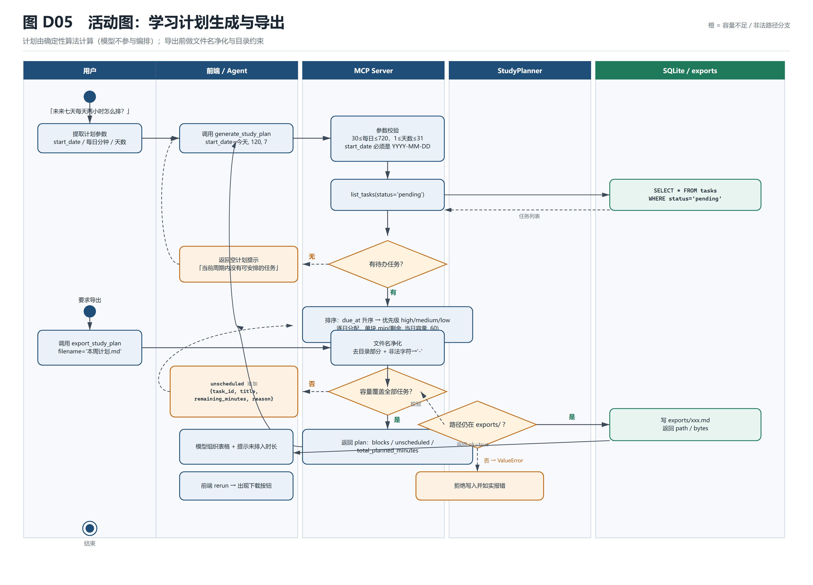

*图 2-5　活动图：学习计划生成与 Markdown 导出*

### 2.3.4 任务状态机

当前实现只有 pending 与 completed 两个状态，且没有软删除。为了让后台管理端的筛选、撤销、冲突重排有明确的状态空间，本期设计把状态机扩展为下图，其中橙色虚线为本期设计新增的迁移；A1–A11 验收仍只覆盖已实现的实线迁移。

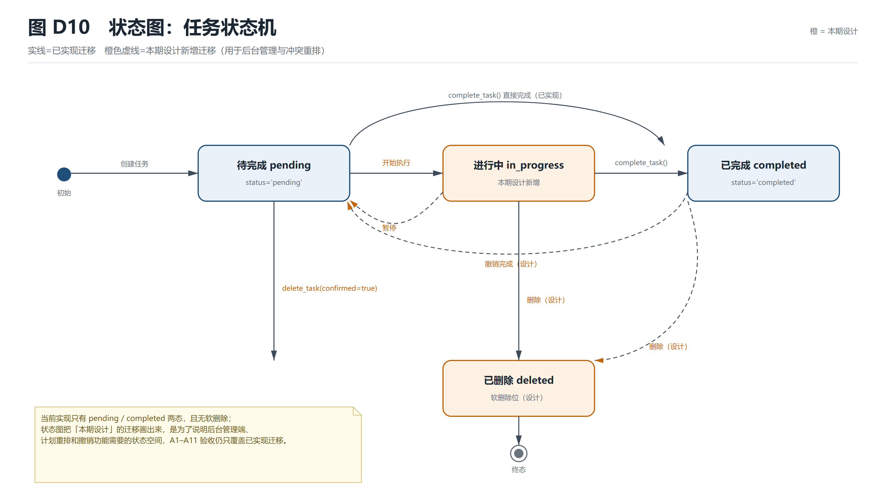

*图 2-6　状态图：任务状态机（实线已实现，虚线本期设计）*

**表 2-3　任务状态迁移表**

| 当前状态 | 事件 | 新状态 | 实现状态 | 说明 |
| --- | --- | --- | --- | --- |
| （无） | add_task 成功 | pending | 已实现 | 创建即待完成 |
| pending | complete_task | completed | 已实现 | 写入 completed_at；重复完成会报错 |
| pending | delete_task(confirmed=true) | deleted | 已实现（硬删除） | 本期设计改为软删除位 |
| pending | 开始执行 | in_progress | 本期设计 | 为后台看板与计划重排提供依据 |
| in_progress | complete_task | completed | 本期设计 | 与 pending→completed 等价 |
| completed | 撤销完成 | pending | 本期设计 | 清空 completed_at |
| in_progress / completed | delete_task(confirmed=true) | deleted | 本期设计 | 保留快照供审计 |

## 2.4 系统结构

系统按职责划分为五层，自顶向下依次是用户层、交互层、智能体层、工具层、数据与外部服务层。分层的判据不是「代码放在哪个目录」，而是「这一层能看见什么」：用户层只能看见页面，智能体层只能看见工具的定义与结果，工具层只能看见仓储与外部服务的函数签名。

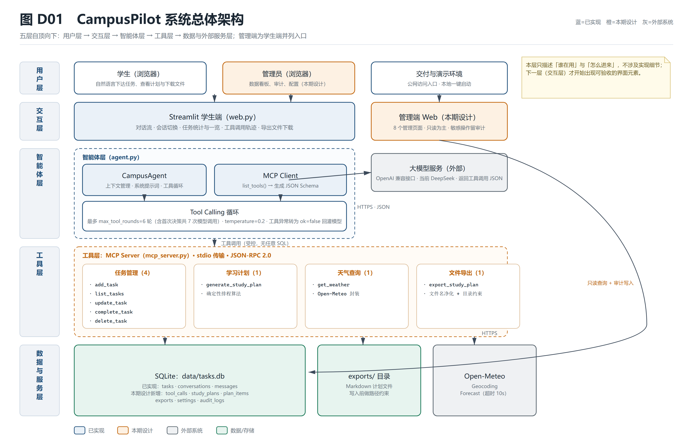

*图 2-7　CampusPilot 系统总体架构（五层 + 管理端并列入口）*

### 2.4.1 各层职责与边界

**表 2-4　分层职责与边界**

| 层次 | 组成 | 职责 | 不允许做的事 |
| --- | --- | --- | --- |
| 用户层 | 学生浏览器、管理员浏览器 | 自然人机交互：输入自然语言、查看结果、点击下载 | 直接访问数据库或工具 |
| 交互层 | Streamlit 学生端 web.py；管理端 Web（本期设计） | 页面渲染、会话状态、工具轨迹展示、下载区、后台表格与表单 | 编写业务规则或 SQL |
| 智能体层 | CampusAgent、MCP Client | 组装系统提示词与历史、驱动 Tool Calling 循环、组织中文回复 | 直接执行 SQL、直接写文件 |
| 工具层 | MCP Server 与 8 个受控工具 | 参数校验、权限与副作用控制、调用仓储与外部服务并标准化返回 | 自由解释自然语言意图 |
| 数据与服务层 | SQLite、exports/ 目录、Open-Meteo、大模型服务 | 持久化、文件读写、外部实时数据 | 承担业务判断 |

### 2.4.2 核心类与依赖关系

与五层结构对应，系统有 9 个实现类（另有 1 个本期设计的 AdminService）。类之间是单向依赖：WebUI 依赖 CampusAgent，CampusAgent 依赖 MCPServer（JSON-RPC），MCPServer 依赖四个仓储/领域服务，仓储依赖 SQLite。依赖方向从不反向，因此模型侧永远拿不到数据库句柄。

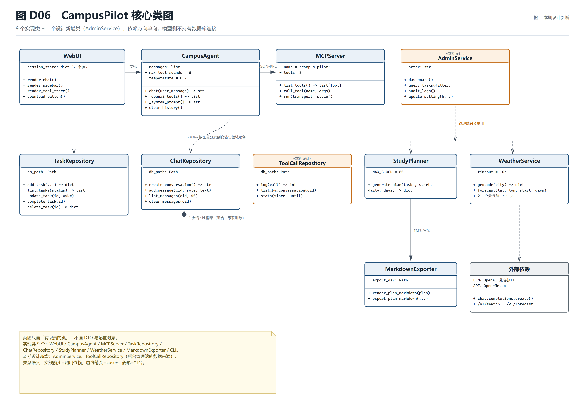

*图 2-8　CampusPilot 核心类图*

### 2.4.3 模块清单

**表 2-5　模块清单与职责**

| 模块 | 文件 | 行数 | 主要职责 | 实现状态 |
| --- | --- | --- | --- | --- |
| 前端页面 | campus_pilot/web.py | 196 | 侧栏会话与统计、聊天区、工具轨迹状态条、下载按钮 | 已实现 |
| 智能体 | campus_pilot/agent.py | 162 | 上下文、系统提示词、Tool Calling 循环（≤6 轮）、消息持久化 | 已实现 |
| 工具层 | campus_pilot/mcp_server.py | 172 | 8 个 @server.tool 工具、stdio 启动、默认路径常量 | 已实现 |
| 数据层 | campus_pilot/database.py | 335 | TaskRepository / ChatRepository、事务上下文、参数化 SQL | 已实现 |
| 计划算法 | campus_pilot/planner.py | 76 | 确定性排程、容量分配、未排入统计 | 已实现 |
| 天气适配 | campus_pilot/weather.py | 129 | 地理编码、逐日预报、21 个天气码中文映射 | 已实现 |
| 文件导出 | campus_pilot/exporter.py | 72 | Markdown 渲染、文件名净化、目录约束 | 已实现 |
| 命令行 | campus_pilot/cli.py | 85 | 终端 REPL（/clear、/quit） | 已实现 |
| 后台服务 | （本期设计）admin_service.py | — | 看板聚合、任务/会话查询、工具日志、配置与审计 | 本期设计 |

## 2.5 功能需求与程序的关系

下表说明每个功能域由哪些模块共同完成，便于评审时逐条对应，也便于测试按模块组织用例。

**表 2-6　功能需求与程序单元的对应关系**

| 功能 | 前端模块 | 智能体模块 | 工具 / 领域模块 | 数据表 | 验收条目 |
| --- | --- | --- | --- | --- | --- |
| F1 自然语言交互 | web.py 聊天区 | agent.py chat() | MCPServer.list_tools | messages | A1 |
| F2 任务管理 | web.py 任务一览 | agent.py 工具循环 | add/list/update/complete/delete_task | tasks | A1、A2 |
| F3 学习计划 | web.py 计划展示 | agent.py 工具循环 | generate_study_plan + planner.py | tasks（本期增 study_plans） | A5 |
| F4 天气查询 | web.py 天气卡片 | agent.py 工具循环 | get_weather + weather.py | 无（不落库） | A4 |
| F5 多轮记忆 | web.py 会话切换 | agent.py messages + initial_messages | ChatRepository | conversations、messages | A3、A8 |
| F6 文件导出 | web.py 下载区 | agent.py 工具循环 | export_study_plan + exporter.py | exports（本期设计） | A6 |
| F7 安全机制 | web.py 确认弹层 | agent.py 参数透传 | delete_task(confirmed) + 路径校验 | tasks | A7、A9 |
| F8 可视化界面 | web.py 全页 | — | on_tool_call 回调 | — | A1 |
| F9 质量保障 | — | — | tests/ 5 个文件 15 个用例 | — | A10 |
| F10 后台管理 | 管理端（本期设计） | — | AdminService + ToolCallRepository | 全部表 | 不纳入本期验收 |

## 2.6 人工处理过程

以下环节本期不由系统自动完成，需要人工介入；在设计上明确标注，避免验收时被误解为缺陷。

- 密钥配置：LLM_API_KEY、LLM_MODEL、LLM_BASE_URL 由使用者写入 .env，仓库只保留 .env.example。
- 数据库初始化：首次运行自动建表（CREATE TABLE IF NOT EXISTS），无需手工执行 DDL；示例数据由使用者按需导入。
- 部署与公网访问：本地 streamlit run 或通过 Cloudflare Tunnel 暴露；隧道地址为临时值，重启后需更新。
- 后台运营：本期后台只读为主，任务清理、配置调整由管理员在后台页面手动操作，并留审计日志。
- 备份：定期复制 data/tasks.db 与 exports/ 目录；恢复时停止应用后覆盖文件。

## 2.7 尚未解决的问题

**表 2-7　尚未解决的问题与处理方式**

| 编号 | 问题 | 影响 | 本期处理方式 |
| --- | --- | --- | --- |
| O1 | 无多用户与鉴权 | 数据不隔离，不能公网多人使用 | 设计 users 表与权限矩阵（A08），本期不实现 |
| O2 | SQLite 单写者 | 高并发写会等待锁 | 单用户场景可接受；物理设计建议开 WAL 与 busy_timeout |
| O3 | 工具轨迹未落库 | 刷新后轨迹丢失，无法事后审计 | 本期设计 tool_calls 表，界面已展示但未持久化 |
| O4 | 计划不持久化 | 每次重算，无法回答「上周计划长什么样」 | 本期设计 study_plans / plan_items |
| O5 | 课程表与校园日历未接入 | 计划只能用「每日可用分钟」近似真实空闲时间 | 列入后续迭代 |
| O6 | 无提醒与推送 | 截止时间仍需用户主动查看 | 列入后续迭代 |

# 第3章 接口设计

## 3.1 用户接口

界面设计的目标不是「好看」，而是让「执行过程可见」。因此每个关键动作都必须有对应的视觉反馈：调用了什么工具、参数是什么、成功还是失败、数据是否真的写入了。下面先给设计系统与页面清单，再用四张原型截图说明关键页面，最后列出交互规则。

### 3.1.1 设计系统

**表 3-1　界面设计系统**

| 要素 | 规范 | 取值 |
| --- | --- | --- |
| 主色 | 品牌与主要按钮、标题 | #1F4E79（深蓝）；浅色底 #EAF1F8 |
| 强调色 | 本期设计新增、警告与未排入提示 | #C2670F（橙）；浅色底 #FDF1E3 |
| 语义色 | 成功 / 失败 | #1E7A5A（绿）/ #C0392B（红） |
| 中性色 | 正文 / 次要文本 / 分割线 / 背景 | #1B2733 / #6B7885 / #E2E8F0 / #F5F7FA |
| 字体 | 中文 / 等宽 | 微软雅黑 / Cascadia Mono、Consolas |
| 字号 | 页面标题 / 卡片标题 / 正文 / 辅助 | 25px / 15–19px / 13–13.5px / 11–12px |
| 间距 | 栅格与圆角 | 8px 基准；卡片圆角 12px，按钮 8px，标签胶囊 999px |
| 布局 | 学生端 / 管理端 | 学生端左栏 322px + 主区自适应；管理端顶栏 56px + 左导航 196px + 主区 |
| 组件库 | 通用 | 顶栏、侧栏、卡片、表格、标签、弹层、提示条、空状态、KPI 卡、分页器 |

### 3.1.2 页面清单

原型共 20 屏：学生端 11 屏（P01–P11）覆盖从空状态到异常提示的完整链路；管理端 9 屏（A01–A09）为本次概要设计新增，标注「本期设计」。每屏都配有交互说明与规则说明，详见《原型设计说明》。

**表 3-2　原型页面清单（20 屏）**

| 编号 | 页面 | 端 | 关键控件 | 验收关注点 |
| --- | --- | --- | --- | --- |
| P01 | 对话空状态与示例引导 | 学生端 | 示例 chips、输入框 | 新用户 10 秒内知道能说什么 |
| P02 | 工具调用轨迹展开 | 学生端 | 状态条、工具名、JSON 参数 | 工具名与参数真实可见（F8） |
| P03 | 一句话建任务成功 | 学生端 | toast、侧栏统计 | 库中确实新增一行（A1） |
| P04 | 任务一览与详情编辑 | 学生端 | 表格、编辑弹层、校验提示 | 1–1440 分钟校验（F2） |
| P05 | 删除二次确认 | 学生端 | 预览卡片、确认按钮 | 未确认不删除（A7） |
| P06 | 学习计划生成 | 学生端 | 按日计划表、容量标签 | 单块≤60 分钟（A5） |
| P07 | 容量不足与未排入任务 | 学生端 | 未排入清单、剩余分钟 | 排不下要说清（A5） |
| P08 | 计划导出与下载 | 学生端 | 文件列表、下载按钮、toast | 导出后自动出现下载（A6） |
| P09 | 会话管理与多轮指代 | 学生端 | 历史记录下拉、指代消息 | 刷新后仍能理解「它」（A3、A8） |
| P10 | 天气查询卡片 | 学生端 | 逐日天气表、来源标注 | 真实数据、失败不编造（A4） |
| P11 | 异常与失败提示 | 学生端 | 错误提示条、助手说明 | 失败不显示成功（BR-03） |
| A01 | 管理员登录 | 管理端 | 账号、密码、验证码 | 本期设计，不纳入验收 |
| A02 | 数据看板 | 管理端 | KPI 卡、趋势柱图、分布条 | 统计口径可解释 |
| A03 | 任务数据管理 | 管理端 | 筛选、表格、分页、导出 CSV | 只读为主 |
| A04 | 会话与消息审计 | 管理端 | 会话列表、消息与轨迹 | 轨迹由 tool_calls 关联 |
| A05 | 工具调用日志 | 管理端 | 日志表、失败率 KPI | 可定位到具体参数 |
| A06 | 计划与导出文件管理 | 管理端 | 计划表、文件表 | 路径约束可视化 |
| A07 | 系统配置 | 管理端 | 参数表单、只读回显 | 密钥不出现在页面 |
| A08 | 用户与权限 | 管理端 | 账号表、权限矩阵 | 数据隔离方案 |
| A09 | 审计与告警 | 管理端 | 审计表、告警表 | 敏感操作留痕 |

### 3.1.3 关键界面

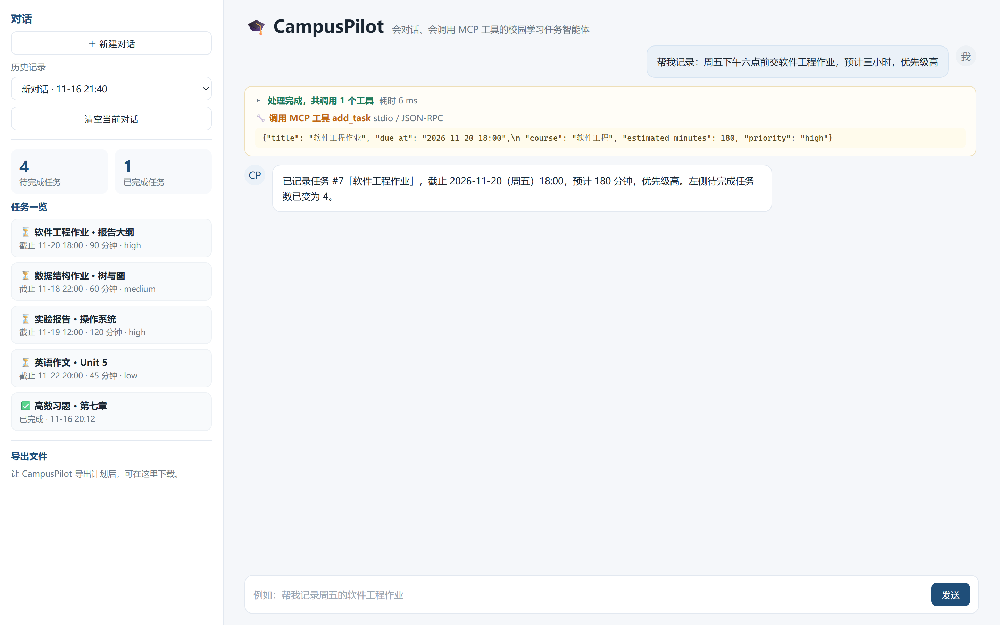

*图 3-1　学生端：工具调用轨迹展开（工具名、JSON 参数、完成状态）*

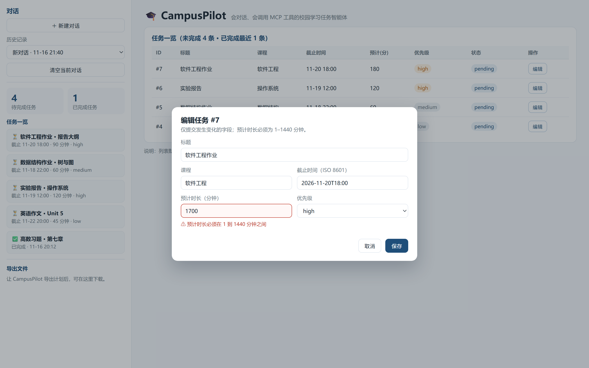

*图 3-2　学生端：任务编辑弹层与参数校验错误态*

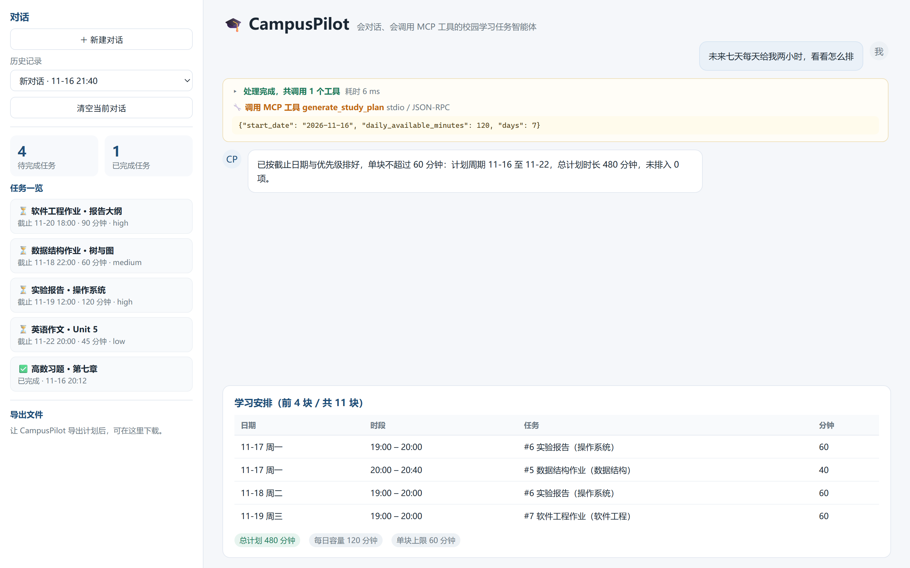

*图 3-3　学生端：学习计划生成结果（按日学习块）*

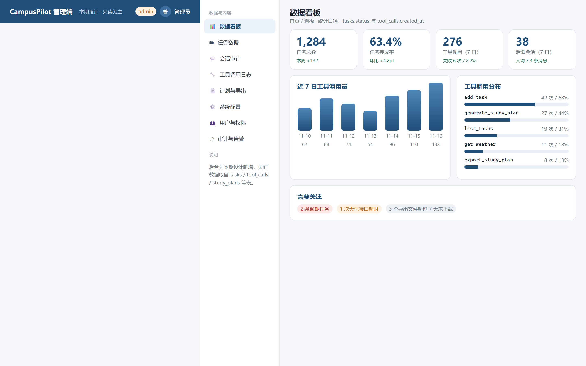

*图 3-4　管理端：数据看板（本期设计）*

### 3.1.4 交互规则

**表 3-3　关键交互规则**

| 编号 | 规则 | 设计意图 |
| --- | --- | --- |
| IR-01 | 输入框只接受自由文本，不提供表单式录入；回车即发送 | 降低录入成本，呼应调研中「字段太多导致放弃」 |
| IR-02 | 每轮回复必须展示本轮调用的工具名与 JSON 参数；未调用工具则明确说明 | 让「是否真的执行」可当场核验 |
| IR-03 | 处理过程以状态条呈现：处理中 → 完成（含工具数）/ 失败（含错误原因） | 避免长耗时请求让用户误以为卡死 |
| IR-04 | 删除必须先返回任务详情并要求确认，确认后才执行 | 把破坏性操作变成两段式 |
| IR-05 | 导出成功后页面自动重新渲染，侧栏出现下载按钮，无需手动刷新 | 导出结果与界面状态强一致 |
| IR-06 | 外部服务失败时显示明确错误文案，不显示「操作成功」 | 失败不伪造 |
| IR-07 | 会话切换后加载该会话最近 40 条消息，标题取首条用户消息前 24 字 | 跨刷新保持多轮记忆 |
| IR-08 | 管理端默认只读，任何写操作都在按钮旁标注「将写入审计日志」 | 降低误操作与越权风险 |

可访问性与适配：正文对比度不低于 4.5:1；所有交互元素可用键盘 Tab 到达；学生端在 1280px 以上宽度保持左右分栏，窄屏时侧栏折叠为抽屉；表格在窄屏下横向滚动而不截断列。

## 3.2 外部接口

系统只调用两类外部服务与一类本地文件系统，全部经工具层间接调用，任何一层都不允许绕过工具直接访问。

### 3.2.1 大模型服务（OpenAI 兼容接口）

**表 3-4　大模型服务接口约定**

| 项 | 内容 |
| --- | --- |
| 接口地址 | 由环境变量 LLM_BASE_URL 指定（当前指向 DeepSeek 的兼容端点） |
| 认证 | LLM_API_KEY，仅存 .env，不进仓库、不入库、不在界面显示 |
| 模型 | 由 LLM_MODEL 指定，例如 deepseek-chat；更换模型只需改配置 |
| 请求要点 | messages（系统提示词 + 历史）、tools（由 MCP 工具 Schema 转换）、tool_choice=auto、temperature=0.2 |
| 响应要点 | choices[0].message.content 或 message.tool_calls[]（含 id、function.name、function.arguments 的 JSON 字符串） |
| 超时与重试 | 请求超时由客户端控制；失败时本轮对话以明确错误结束，不自动重试以避免重复副作用 |
| 失败处理 | 异常向上抛出，由界面显示错误状态；不生成任何伪造结果 |

### 3.2.2 天气服务（Open-Meteo）

**表 3-5　天气服务接口约定**

| 项 | 内容 |
| --- | --- |
| 地理编码 | GET https://geocoding-api.open-meteo.com/v1/search?name={城市}&count=1&language=zh&format=json |
| 逐日预报 | GET https://api.open-meteo.com/v1/forecast?latitude&longitude&daily=weather_code,temperature_2m_max,temperature_2m_min,precipitation_probability_max&timezone=auto&start_date&end_date |
| 超时 | 10 秒（urllib 的 timeout 参数） |
| 参数校验 | 城市不能为空；start_date 必须为 YYYY-MM-DD；天数 1–7 |
| 返回字段 | location、latitude、longitude、timezone、forecasts、source |
| forecasts 单项 | date、weather_code、weather（中文）、temperature_max_c、temperature_min_c、precipitation_probability_percent |
| 天气码映射 | 21 个 WMO 代码映射为中文（0 晴、1 大致晴朗、2 局部多云、3 阴、45/48 雾、51/53/55 毛毛雨、61/63/65 小/中/大雨、71/73/75 小/中/大雪、80/81/82 阵雨、95/96/99 雷暴），未命中回退「未知天气代码 N」 |
| 失败语义 | 找不到城市抛 LookupError；网络异常抛 RuntimeError；不返回任何编造数据 |

### 3.2.3 文件系统（exports/）

导出接口只有一个方向：工具写、界面读。写入前先取文件名最后一段（去掉目录部分），再用正则把字母、数字、下划线、点、连字符与中文之外的字符合并为 '-'，最后强制 .md 后缀；目标路径 resolve 后必须仍以 exports/ 为父目录，否则抛 ValueError。读取时界面只列 *.md 并按修改时间倒序取前 5 个。

### 3.2.4 错误码约定

系统内部错误统一采用 E 开头 + 三位数字的编号，便于日志检索与用户沟通。完整错误码表见 6.1 节，外部接口层面的对应关系是：E3xx 一律来自外部服务，E1xx 一律来自参数校验。

## 3.3 内部接口

内部接口有两类：一是智能体层与工具层之间的 MCP 调用（JSON-RPC over stdio），二是工具层与仓储/领域服务之间的函数调用。前者由协议约束，后者由类型注解与返回值约定。

### 3.3.1 受控工具清单

**表 3-6　MCP 受控工具清单**

| # | 工具 | 主要参数 | 返回字段 | 副作用与约束 |
| --- | --- | --- | --- | --- |
| 1 | add_task | title, due_at, course='', estimated_minutes=60, priority='medium' | ok, message, task | 写：INSERT tasks；标题非空、时长 1–1440、时间 ISO 8601 |
| 2 | list_tasks | status='pending' | ok, status, count, tasks | 只读；按优先级→截止时间排序 |
| 3 | complete_task | task_id | ok, message, task | 写：仅 pending 可完成，重复完成报错 |
| 4 | update_task | task_id + 任一待改字段 | ok, message, task | 写：只更新传入字段，至少传一个 |
| 5 | delete_task | task_id, confirmed=False | ok, requires_confirmation, message, task | 写：confirmed=false 只预览不删除；true 才 DELETE |
| 6 | generate_study_plan | start_date, daily_available_minutes=120, days=7 | ok, message, start_date, end_date, daily_available_minutes, blocks, unscheduled, total_planned_minutes | 只读＋计算；每日 30–720 分钟，天数 1–31 |
| 7 | get_weather | city, start_date, days=3 | ok, message, location, latitude, longitude, timezone, forecasts, source | 外部调用；超时 10 秒，天数 1–7 |
| 8 | export_study_plan | start_date, daily_available_minutes=120, days=7, filename='study-plan.md' | ok, message, filename, path, bytes, plan | 写文件：限制在 exports/，文件名净化 |

### 3.3.2 MCP 消息示例

模型返回的工具调用由 CampusAgent 转成 MCP 请求；工具执行结果再被序列化为 JSON 回灌模型。下例是一次完整的 add_task 调用（为可读性省略了协议字段）。

```
{
"method": "tools/call",
"params": {
"name": "add_task",
"arguments": {
"title": "软件工程作业",
"due_at": "2026-11-20 18:00",
"course": "软件工程",
"estimated_minutes": 180,
"priority": "high"
}
}
}

```

```
结果（structured_content）：
{
"ok": true,
"message": "任务已创建",
"task": { "id": 1284, "title": "软件工程作业", "due_at": "2026-11-20T18:00",
"estimated_minutes": 180, "priority": "high", "status": "pending", ... }
}

```

### 3.3.3 模块间的调用关系

**表 3-7　模块间调用关系**

| 调用方 | 被调方 | 方式 | 频率 | 失败时的行为 |
| --- | --- | --- | --- | --- |
| WebUI | CampusAgent | 直接方法调用 chat() | 每次用户发言一次 | 捕获异常并显示错误状态条 |
| CampusAgent | 大模型服务 | HTTPS（OpenAI SDK） | 每轮 1–7 次 | 异常上抛，本轮对话失败 |
| CampusAgent | MCPServer | MCP list_tools / call_tool（stdio） | 每轮 1 次列表 + 每次调用 | 错误转为 ok=false 回灌模型 |
| MCPServer | TaskRepository / ChatRepository | 方法调用 | 按工具调用次数 | 异常转为工具错误结果 |
| MCPServer | StudyPlanner | 纯函数调用 | 计划与导出时 | 参数非法抛 ValueError |
| MCPServer | WeatherService | 方法调用 → HTTP | 天气工具调用时 | 超时或异常转为明确错误 |
| MCPServer | MarkdownExporter | 方法调用 → 文件写入 | 导出工具调用时 | 路径越界抛 ValueError |
| AdminService | 各 Repository（只读） | 方法调用 | 后台页面加载时 | 显示空状态与错误提示 |

# 第4章 运行设计

## 4.1 运行模块组合

系统没有常驻的调度器，所有行为都由用户操作触发。按场景可以把参与的模块组合列为下表，这张表同时是排查问题时的「责任链」：一次请求出了问题，按顺序检查对应模块即可。

**表 4-1　运行模块组合**

| 场景 | 触发 | 模块执行序列 | 结束条件 |
| --- | --- | --- | --- |
| 对话创建任务 | 用户输入自然语言 | WebUI → CampusAgent → 大模型 → MCP Client → MCPServer(add_task) → TaskRepository → SQLite → 回灌模型 → WebUI | 模型返回最终文本 |
| 生成并导出计划 | 用户要求排计划/导出 | WebUI → CampusAgent → MCPServer(generate_study_plan) → TaskRepository(list_tasks) → StudyPlanner → 返回 plan →（可选）MarkdownExporter 写 exports/ | 返回 plan 或文件路径 |
| 查询天气 | 用户问天气/是否适合外出 | WebUI → CampusAgent → MCPServer(get_weather) → WeatherService → Open-Meteo → 回灌模型 → 自然语言建议 | 拿到逐日数据或明确错误 |
| 后台巡检（本期设计） | 管理员打开看板 | 管理端 → AdminService → 各 Repository 只读查询 → 看板渲染 | 页面渲染完成 |

## 4.2 运行控制

运行控制要回答三个问题：一次对话如何开始与结束、循环如何收敛、失败如何收场。下面三张图依次给出：工具调用循环的时序、删除二次确认的两段式时序，以及同一场景的协作图（静态连接关系）。

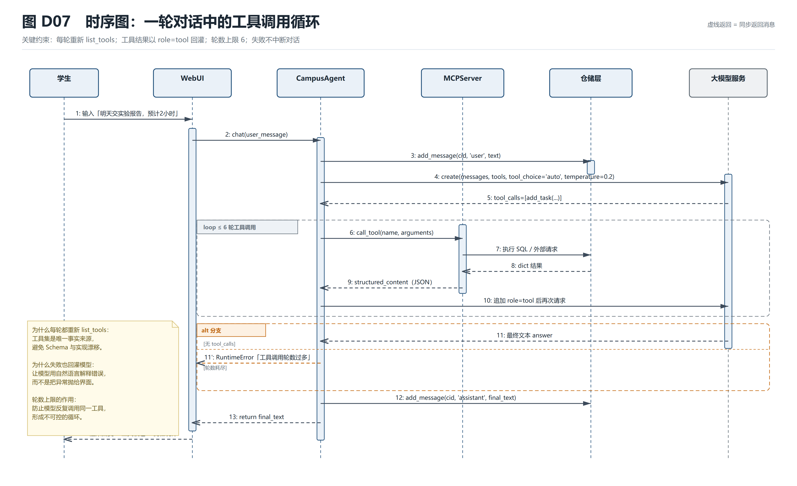

*图 4-1　时序图：一轮对话中的工具调用循环（上限 6 轮）*

循环的收敛依赖两个机制：一是轮数上限 max_tool_rounds=6（含首次决策共 7 次模型调用），超过即抛 RuntimeError 并由界面提示；二是每轮都要求模型给出最终文本或工具调用，模型返回无 tool_calls 时立即结束，不会空转。

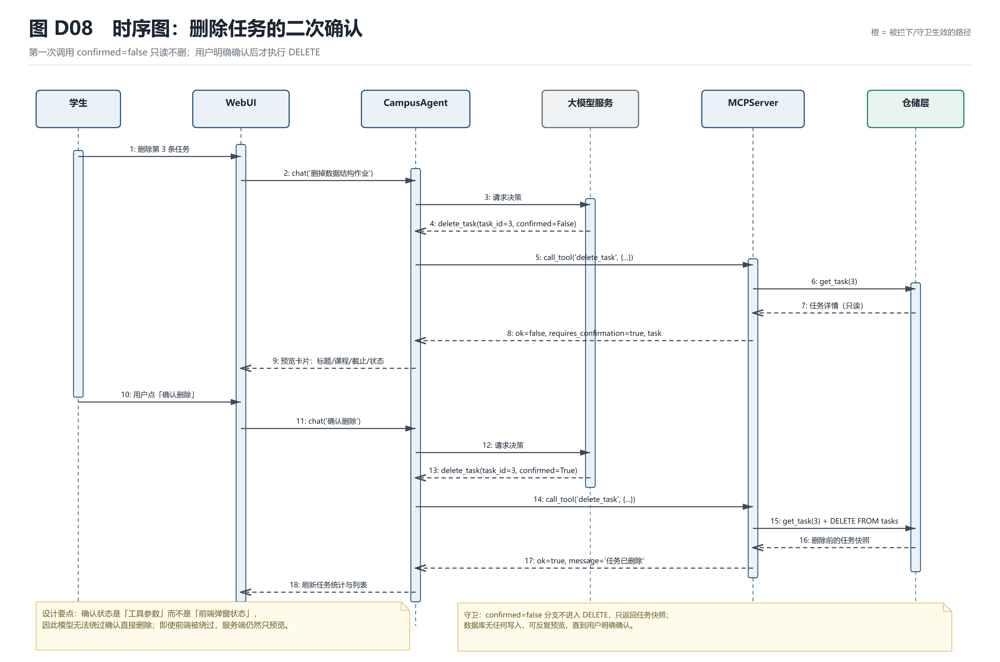

*图 4-2　时序图：删除任务的二次确认（首次调用无副作用）*

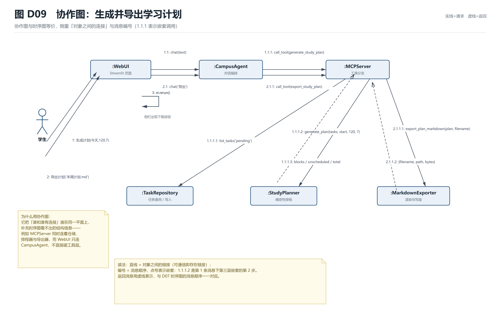

*图 4-3　协作图：生成并导出学习计划的对象协作与消息编号*

### 4.2.1 会话生命周期

**表 4-2　会话生命周期**

| 阶段 | 动作 | 涉及数据 | 说明 |
| --- | --- | --- | --- |
| 创建 | 点击「新建对话」 | conversations 新增一行 | 标题默认「新对话」，uuid4().hex 作为主键 |
| 命名 | 首条用户消息写入 | 更新 conversations.title | 取消息前 24 字，空则保持「新对话」 |
| 追加 | 每轮用户/助手消息 | messages 新增行 | 只存 user 与 assistant，工具消息不存 |
| 加载 | 切换会话或刷新页面 | 读取最近 40 条 | 作为 initial_messages 注入上下文 |
| 清空 | 点击「清空当前对话」 | 删除该会话消息、标题重置 | 会话本身保留 |
| 排序 | 列表展示 | ORDER BY updated_at DESC | 取最近 30 个会话 |

### 4.2.2 并发与资源控制

- 单进程模型：Streamlit 每次交互在同步上下文中通过 asyncio.run 执行一次智能体调用，天然串行，不存在写写并发。
- 每请求短连接：数据库连接按调用创建、提交/回滚后立即关闭，避免长事务持有锁。
- 外部调用超时：天气接口 10 秒；大模型调用由客户端默认超时控制；超时即失败，不重试副作用操作。
- 写操作幂等性：complete_task 对已完成任务报错而非重复写；delete_task 需 confirmed=true 才执行。
- 最大轮数与最大返回：循环上限 6；工具结果序列化后回灌，超大对象在落库时截断至 8KB（本期设计）。

## 4.3 运行时间

性能预算按课程项目的真实体验设定：用户感知的关键指标是「首字延迟」与「工具调用往返」。下表为设计目标与当前实现的估算，不是压测结论。

**表 4-3　运行时间预算**

| 环节 | 设计目标 | 当前实现依据 | 备注 |
| --- | --- | --- | --- |
| 模型首字响应 | ≤ 3 秒 | 取决于外部服务与网络 | 不可控，靠状态条缓解焦虑 |
| 单次工具调用（本地） | ≤ 50 毫秒 | SQLite 本地文件访问 | 实测量级为毫秒级 |
| 计划生成（100 个任务，7 天） | ≤ 20 毫秒 | 排序 O(n log n) + 分配 O(n·d) | 纯内存计算 |
| 天气查询 | ≤ 2 秒 | 两次 HTTP（geocoding + forecast），超时 10 秒 | 外部依赖 |
| Markdown 导出 | ≤ 30 毫秒 | 字符串渲染 + 单次写盘 | 文件通常 < 10KB |
| 页面重渲染 | ≤ 1 秒 | Streamlit 重跑 + 数据库读取 | 导出后额外 rerun 一次 |

容量估算：单用户场景下，一年按每天 5 个任务、20 条消息计算，tasks 约 1.8 千行、messages 约 7 千行，SQLite 文件预计在 10MB 以内；若开日志表 tool_calls（每次调用一行），一年约 2 万行，仍远低于 SQLite 的实用上限。因此本期不做分库分表，物理设计只需保证索引与定期备份。

# 第5章 系统数据结构设计

## 5.1 逻辑结构设计要点

系统共 9 张表：3 张已实现（tasks、conversations、messages），6 张本期设计（tool_calls、study_plans、plan_items、exports、settings、audit_logs），另有 users 表作为多用户方案的预留（不纳入本期范围）。完整的字段、类型、约束、索引与 DDL 见配套的《数据库设计说明书》，本节只说明与程序结构相关的要点。

**表 5-1　逻辑实体清单**

| 表 | 类别 | 对应实体 | 主要用途 |
| --- | --- | --- | --- |
| tasks | 已实现 | Task | 任务本体：标题、课程、截止时间、预计时长、优先级、状态 |
| conversations | 已实现 | Conversation | 会话容器：标题、创建与更新时间 |
| messages | 已实现 | Message | 会话内可见消息：角色（user/assistant）、内容、时间 |
| tool_calls | 本期设计 | ToolCall | 工具调用轨迹：工具名、参数、结果、状态、耗时 |
| study_plans | 本期设计 | StudyPlan | 计划头：周期、每日容量、总计划分钟、来源调用 |
| plan_items | 本期设计 | PlanItem | 计划明细：一条记录 = 一个学习块 |
| exports | 本期设计 | ExportFile | 导出文件登记：文件名、路径、字节数 |
| settings | 本期设计 | Setting | 运行期配置键值对 |
| audit_logs | 本期设计 | AuditLog | 后台敏感操作审计 |
| users | 预留 | User | 多用户与角色（A08 设计稿，不建表） |

## 5.2 物理结构设计要点

数据库为单文件 SQLite，默认路径 ./data/tasks.db（可用环境变量 CAMPUS_PILOT_DB 覆盖）。当前实现只在 ChatRepository 的连接上设置 PRAGMA foreign_keys=ON，TaskRepository 未设置；未开启 WAL。基于运行设计中的并发分析，本期提出三条物理改进建议，作为 v1.1 的落地项。

**表 5-2　物理设计现状与改进建议**

| 项 | 当前实现 | 本期建议 | 原因 |
| --- | --- | --- | --- |
| 日志模式 | 默认 journal_mode=delete | PRAGMA journal_mode=WAL | 读写不互相阻塞，页面重渲染时更稳 |
| 锁等待 | 默认立即报 SQLITE_BUSY | PRAGMA busy_timeout=5000 | 避免瞬时并发导致界面报错 |
| 外键 | 仅 ChatRepository 开启 | 两个 Repository 统一开启 foreign_keys=ON | 保证 messages 级联删除语义一致 |
| 索引 | 仅 idx_messages_conversation | 新增 idx_tasks_status_due(status, due_at)、idx_tool_calls_created(created_at) | 支撑列表排序与日志查询 |
| 文件权限 | 依赖操作系统默认 | data/ 目录 0700、库文件 0600 | 避免同机其他用户读取任务数据 |
| 备份 | 手工复制 | 每日复制 tasks.db 到 backups/（保留 7 份） | 误删与损坏可恢复 |

## 5.3 数据结构与程序的关系

下表说明每张表被哪些模块读写，是评审时判断「有没有越权访问」的依据：除 AdminService（只读）外，任何模块都只操作自己职责范围内的表。

**表 5-3　数据结构与程序的关系**

| 表 | 写入方 | 读取方 | 访问方式 |
| --- | --- | --- | --- |
| tasks | TaskRepository（经 add/update/complete/delete_task 工具） | TaskRepository、StudyPlanner、AdminService（只读） | 参数化 SQL |
| conversations | ChatRepository（新建、更新标题与时间） | ChatRepository、AdminService | 参数化 SQL |
| messages | ChatRepository（每轮用户/助手消息） | ChatRepository、AdminService | 参数化 SQL |
| tool_calls | ToolCallRepository（本期设计） | AdminService、看板统计 | 参数化 SQL |
| study_plans / plan_items | PlanRepository（本期设计） | AdminService、计划历史回溯 | 参数化 SQL |
| exports | MarkdownExporter 登记（本期设计） | WebUI 下载区、AdminService | 参数化 SQL + 文件系统 |
| settings | AdminService（本期设计） | CampusAgent、StudyPlanner、WeatherService 启动时读取 | 键值读取 |
| audit_logs | AdminService（本期设计） | AdminService 审计页 | 只追加，不更新不删除 |

# 第6章 系统出错处理设计

## 6.1 出错信息

错误处理遵循一条硬规则：任何失败都必须以明确结果返回，不得被描述为成功。工具层把异常转换为 ok=false 的结果对象回灌模型，模型据此用自然语言解释；界面同时显示红色的错误提示。下表为错误码约定。

**表 6-1　出错信息与错误码**

| 错误码 | 触发条件 | 返回形式 | 用户可见文案（示例） |
| --- | --- | --- | --- |
| E101 | 标题为空 | ValueError → ok=false | 任务标题不能为空 |
| E102 | 截止时间不是 ISO 8601 | ValueError | due_at 必须是 ISO 8601 格式，例如 2026-10-30 18:00 |
| E103 | 预计时长不在 1–1440 | ValueError | 预计时长必须在 1 到 1440 分钟之间 |
| E104 | 优先级不在 low/medium/high | ValueError | priority 只能是 low、medium 或 high |
| E105 | 更新时未提供任何字段 | ValueError | 至少需要提供一个要修改的字段 |
| E201 | 任务不存在 | LookupError → ok=false | 未找到 ID 为 N 的任务 |
| E202 | 对已完成任务再次完成 | ValueError | 任务 N 已经完成，无需重复操作 |
| E203 | 删除未确认 | ok=false + requires_confirmation=true | 尚未删除，请向用户确认 |
| E301 | 天气服务网络异常/超时 | RuntimeError | 天气服务请求失败：<原始错误> |
| E302 | 城市不存在 | LookupError | 没有找到城市：<城市名> |
| E303 | 天气查询天数越界 | ValueError | 天气查询天数必须在 1 到 7 天之间 |
| E304 | 逐日数据缺失 | RuntimeError | 天气服务没有返回逐日预报 |
| E401 | 模型生成的工具参数不是合法 JSON | 转为 ok=false 回灌 | 模型生成了无效工具参数：<错误> |
| E402 | 工具执行异常 | 转为 ok=false 回灌 | <工具返回的错误信息> |
| E403 | 工具调用轮数耗尽 | RuntimeError | 工具调用轮数过多，已停止以避免无限循环 |
| E501 | 导出路径越界 | ValueError | 导出文件必须位于 exports 目录 |
| E502 | 导出文件名为空 | 自动回退 | 自动命名为 study-plan-<起始日>.md |
| E503 | 数据库文件不可写 | 异常上抛 | 请求失败：<错误信息>（界面显示红色提示） |

## 6.2 补救措施

不同性质的错误对应不同的补救手段，原则是「能自动恢复的自动恢复，不能的如实告知，绝不假装成功」。

**表 6-2　补救措施矩阵**

| 错误性质 | 补救手段 | 实现位置 | 对用户的影响 |
| --- | --- | --- | --- |
| 数据库操作失败 | 事务回滚并关闭连接，异常上抛 | Repository 的 _connect 上下文管理器 | 本轮操作失败，数据无变化 |
| 参数非法 | 不执行副作用，返回明确错误 | Repository / planner / weather 的入口校验 | 模型解释原因并建议修正 |
| 删除未确认 | 只返回快照，不写入 | delete_task(confirmed=false) | 可反复预览，无副作用 |
| 外部服务超时 | 不重试、不缓存旧数据，直接报错 | weather.py 的 urlopen timeout | 提示稍后再试，不编造天气 |
| 模型参数非法 JSON | 解析失败当作工具错误回灌 | agent.py 的 json.loads 异常处理 | 本轮继续，模型自我修正 |
| 轮数耗尽 | 中止循环并抛错 | agent.py 的循环计数 | 提示重试或改写问题 |
| 导出路径越界 | 拒绝写入 | exporter.py 的父目录校验 | 提示文件名不合法 |
| 进程异常退出 | 依赖 SQLite 事务原子性，重启后数据一致 | SQLite 自身 | 重启后继续使用 |

## 6.3 系统维护设计

维护设计的核心是「出问题后能在 10 分钟内定位」。为此需要三类信息：日志、指标、配置。本期设计把工具轨迹落库（tool_calls），正是为了让第三类信息可追溯。

**表 6-3　维护信息清单**

| 类别 | 内容 | 当前状态 | 本期设计 |
| --- | --- | --- | --- |
| 日志 | 工具调用名称、参数、结果、耗时、状态 | 仅界面可见，刷新即丢 | 落库 tool_calls，后台可检索 |
| 日志 | 模型调用轮次与失败原因 | 无结构化记录 | 随 tool_calls 记录相关联的失败 |
| 指标 | 任务完成率、工具调用量、失败率、P95 耗时 | 无 | 后台看板 A02/A05 |
| 配置 | 模型地址、模型名、轮数上限、超时、每日容量 | .env 与代码常量 | settings 表 + 后台配置页 A07 |
| 审计 | 配置变更、数据删除、导出下载 | 无 | audit_logs + 审计页 A09 |
| 备份 | 数据库与导出文件 | 手工复制 | 每日复制 + 保留 7 份（运维脚本） |

版本演进策略：数据库改动一律以「新增表 / 新增可空列」为优先，避免破坏已有数据；破坏性变更走迁移脚本并在 settings 中记录 schema_version。接口层面，工具签名只增不改，弃用参数先保留一个版本并在文档标注。

# 第7章 需求可追踪性与验证

## 7.1 追踪矩阵

下表把需求文档中的验收条目、功能编号、实现模块与测试用例连成一条线，用于确认「每条验收都有代码支撑」。

**表 7-1　需求—功能—模块—测试追踪矩阵**

| 验收 | 验收内容 | 功能 | 实现模块 | 验证方式 |
| --- | --- | --- | --- | --- |
| A1 | 一句话创建任务 | F1、F2 | agent.py / mcp_server.add_task / database.TaskRepository | 手工 + test_mcp_tools |
| A2 | 任务增删改查 | F2 | mcp_server 四个任务工具 + TaskRepository | test_database、test_mcp_tools |
| A3 | 多轮指代理解 | F5 | agent.py messages / ChatRepository | 手工 + test_agent |
| A4 | 真实天气 | F4 | weather.WeatherService | test_weather_exporter（stub） |
| A5 | 学习计划可解释 | F3 | planner.generate_plan | test_planner |
| A6 | 计划导出下载 | F6 | exporter.export_plan_markdown + web.py 下载区 | test_weather_exporter |
| A7 | 删除二次确认 | F7 | mcp_server.delete_task(confirmed) | test_mcp_tools |
| A8 | 记忆持久化 | F5 | ChatRepository + web.py initial_messages | test_database |
| A9 | 安全边界 | F7 | exporter 路径校验、.gitignore、工具白名单 | test_weather_exporter + 人工检查 |
| A10 | 自动化测试 | F9 | tests/ 5 个文件 15 个用例 | python -m unittest discover -s tests -v |
| A11 | 上线可检查 | — | README + 部署说明 | 人工按 README 复现 |

## 7.2 验证方法与测试覆盖

**表 7-2　自动化测试覆盖分布（共 15 项）**

| 测试文件 | 用例数 | 覆盖内容 |
| --- | --- | --- |
| tests/test_database.py | 5 | 任务增改删查、非法参数拒绝、优先级+截止排序、会话消息跨实例持久化 |
| tests/test_mcp_tools.py | 3 | 工具可发现性、完整业务流、更新/计划/确认删除、天气与导出工具 |
| tests/test_planner.py | 2 | 容量与截止约束、非法参数拒绝 |
| tests/test_agent.py | 1 | 模型工具调用经 MCP 真实执行 |
| tests/test_weather_exporter.py | 4 | 天气归一化、未知城市与非法天数、Markdown 渲染与导出、路径穿越被拒绝 |

验证分三层：单元测试覆盖纯逻辑（数据库、算法、解析、导出）；集成测试覆盖工具链与智能体循环（用 stub 替代模型与网络，不发真实请求）；手工验收覆盖界面与端到端体验（按 A1–A11 逐条操作）。三者互补，任何一层都不能单独作为「功能正确」的证据。

# 第8章 附录

## 附录 A 图形符号说明

全文图表使用统一的 UML 2.5 记法与配色语义，避免同一含义在不同图中出现不同符号。

**表 8-1　图形符号与配色语义**

| 符号 / 元素 | 含义 | 出现图 |
| --- | --- | --- |
| 矩形（圆角） | 类、组件、节点或活动节点 | D01、D04、D05、D06、D12 |
| 椭圆 | 用例 | D03 |
| 火柴人 | 参与者（人或外部系统） | D03 |
| 虚线开放箭头 | «include» / «extend» / 依赖关系 | D03、D06 |
| 实线实心箭头 | 控制流、调用依赖、消息发送 | D04、D05、D06、D07、D08 |
| 虚线箭头（时序图） | 同步返回消息 | D07、D08 |
| 菱形判断 | 分支条件（是/否） | D04、D05 |
| 泳道 | 动作的执行者归属 | D04、D05 |
| 生命线与激活条 | 对象在时间轴上的存活与执行期 | D07、D08 |
| 圆角矩形 + 编号消息 | 协作图中的对象与嵌套消息顺序 | D09 |
| 圆角状态框 + 实心圆 | 状态与终止状态 | D10 |
| 实体框（PK/FK 标记）+ 基数标注 | 表、主外键、1:N 关系 | D11 |
| 三维节点框 | 部署节点（进程/设备/外部服务） | D12 |
| 蓝色元素 | 已实现（v0.1.0 代码中存在） | 全部 |
| 橙色元素 | 本期设计新增（尚未实现） | D01–D12 |
| 灰色元素 | 外部系统 | D01、D06、D12 |

## 附录 B 代码索引

**表 8-2　代码索引（行数为含空行统计）**

| 文件 | 行数 | 关键内容 |
| --- | --- | --- |
| campus_pilot/web.py | 196 | 页面布局、会话切换、工具轨迹回调、下载区、导出后 rerun |
| campus_pilot/agent.py | 162 | 系统提示词、工具 Schema 转换、调用循环、消息持久化 |
| campus_pilot/mcp_server.py | 172 | 8 个工具、默认路径常量、stdio 启动 |
| campus_pilot/database.py | 335 | TaskRepository、ChatRepository、事务上下文 |
| campus_pilot/planner.py | 76 | generate_plan：排序、分块、未排入统计 |
| campus_pilot/weather.py | 129 | 地理编码、逐日预报、天气码映射 |
| campus_pilot/exporter.py | 72 | Markdown 模板、文件名净化、目录约束 |
| campus_pilot/cli.py | 85 | 终端 REPL |

文末说明：本文档为 Word 提交稿（.docx）。如需 PDF，可在 Word 中「文件 → 导出 → 创建 PDF」，或在打开时按提示更新目录域后再导出，以确保目录页码与正文一致。
